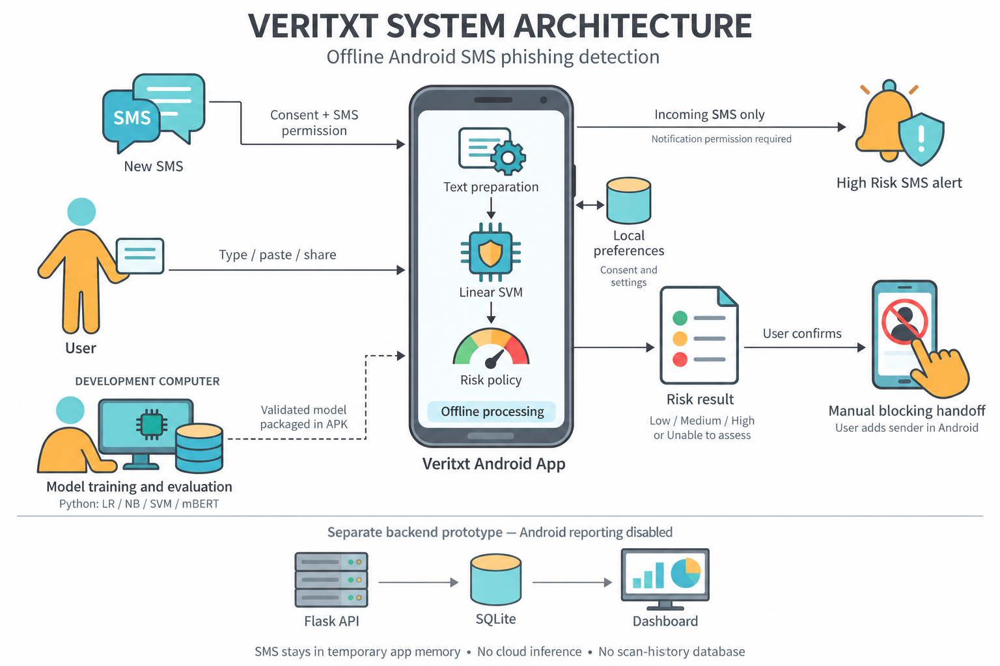

# Veritxt system architecture

Code snapshot: 19 October 2026. This describes the current working tree, including local changes. The main inference path shown is the `selectedSvm` build; other build variants use different detectors.

For a concise explanation of each component's function, see the [architecture README](architecture/README.md).

[Detailed component diagram](architecture/veritxt-system-architecture.png) · [Vector component diagram](architecture/veritxt-system-architecture.svg) · [Editable Mermaid diagram](veritxt-system-architecture.mmd)

The pictorial overview uses the built-in image-generation tool and the user's supplied diagram as a style reference. Its [generation prompt](architecture/veritxt-system-architecture-illustrated-prompt.txt) records the visual specification. The linked detailed component diagram is available separately for implementation-level reading.

## Architecture description

Veritxt is an offline Android SMS phishing detection prototype built with Kotlin and Jetpack Compose. Its presentation layer uses `MainActivity`, while `CheckViewModel` exposes temporary checking state through `StateFlow`. The application layer, `SmishGuardApp`, loads the build-specific detector and serializes inference. A shared `RiskPolicy` combines visible message indicators with the detector's suspicious flag to produce the risk assessment used by results and incoming-SMS warnings.

Training and evaluation run separately in Python on a development computer. Frozen model assets are packaged into a specific APK; the phone does not train models or contact a prediction server. Reporting is disabled. The repository's Flask/SQLite dashboard is a separate local prototype without an Android connection.

## Components and source mapping

| Layer / component | Responsibility | Code evidence |
|---|---|---|
| Android entry points | Launcher, shared plain text, SMS broadcasts, notification actions; declares SMS and notification permissions | [AndroidManifest.xml](../android/app/src/main/AndroidManifest.xml) |
| Presentation | Privacy notice, onboarding, Home, Check, Results, Settings, Help, language selection and blocking confirmation | [MainActivity.kt](../android/app/src/main/java/ph/smishguard/MainActivity.kt) |
| State and coordination | `CheckState` / `StateFlow`, scan jobs, cancellation, slow-work notice, timeout and session clearing | [CheckViewModel.kt](../android/app/src/main/java/ph/smishguard/CheckViewModel.kt) |
| Application services | Lazy detector loading, immutable detector cache, inference mutex, build-specific detector selection and disabled reporting repository | [SmishGuardApp.kt](../android/app/src/main/java/ph/smishguard/SmishGuardApp.kt) |
| Local preferences | Privacy notice version/date, onboarding, incoming-check consent and reduced transparency | [PreferencesRepository.kt](../android/app/src/main/java/ph/smishguard/data/PreferencesRepository.kt) |
| Selected SVM inference | Raw-message adapter, assessability checks, feature extraction, Linear SVM margin, fitted sigmoid and stored decision threshold | [SelectedSvmDetector.kt](../android/app/src/main/java/ph/smishguard/model/SelectedSvmDetector.kt), [SelectedSvmScorer.kt](../android/app/src/main/java/ph/smishguard/model/SelectedSvmScorer.kt), [RawSmsView.kt](../android/app/src/main/java/ph/smishguard/model/RawSmsView.kt) |
| Shared risk assessment | Input-kind handling; credential, payment, urgency and URL indicators; model signal; risk bands and abstention | [RiskAssessment.kt](../android/app/src/main/java/ph/smishguard/model/RiskAssessment.kt) |
| Incoming SMS | Consent/permission checks, multipart assembly, sender normalization, automatic-warning eligibility and High Risk decision | [IncomingSmsReceiver.kt](../android/app/src/main/java/ph/smishguard/sms/IncomingSmsReceiver.kt), [SenderNumbers.kt](../android/app/src/main/java/ph/smishguard/sms/SenderNumbers.kt) |
| Notifications and pending state | Private/generic notifications, single-use pending IDs, in-memory SMS/sender storage, dismissal and expiry | [CheckPrompt.kt](../android/app/src/main/java/ph/smishguard/sms/CheckPrompt.kt) |
| Manual blocking handoff | Confirmation state, opening Android's blocked-number UI and fallback instructions; explicit optional copy-number action | [ManualBlocking.kt](../android/app/src/main/java/ph/smishguard/model/ManualBlocking.kt), [SystemNumberBlocking.kt](../android/app/src/main/java/ph/smishguard/blocking/SystemNumberBlocking.kt), [SenderNumberClipboard.kt](../android/app/src/main/java/ph/smishguard/blocking/SenderNumberClipboard.kt) |
| Reporting stub | Limited payload builder and unavailable submission implementation | [Reports.kt](../android/app/src/main/java/ph/smishguard/privacy/Reports.kt) |
| Research and packaging | Private data preparation, experiment-specific training/evaluation, exports, parity checks and variant-specific asset checks | [research/README.md](../research/README.md), [app/build.gradle.kts](../android/app/build.gradle.kts), [scripts/build.ps1](../scripts/build.ps1) |
| Standalone backend | Flask validation and report endpoint, SQLite storage, aggregate HTML dashboard | [backend/app.py](../backend/app.py) |

## Main data flows

### 1. Manual or shared-message checking

1. The user accepts the privacy notice and completes onboarding. They type/paste a message or share `text/plain` from another Android application.
2. `MainActivity` routes the text to `CheckViewModel`. The ViewModel limits input to 10,000 characters, manages the scan job and publishes state updates.
3. `SmishGuardApp.assess()` gates the input kind, takes an inference mutex and obtains the cached build-specific detector. Model parameters are cached; checked messages and predictions are not cached by this service.
4. For `selectedSvm`, `RawSmsView` cleans placeholders/whitespace and masks URLs, email addresses and ASCII digits. The scorer reproduces its frozen Unicode tokenization, stopword filtering, word unigrams/bigrams, raw term counts, IDF weighting and L2 normalization.
5. The scorer checks assessability, computes the Linear SVM margin, applies the fitted sigmoid and uses the asset's inclusive decision threshold. It returns a `Detection` result.
6. `RiskPolicy` evaluates the original text and detection result. The result screen shows a risk band, evidence indicators, limitations and a temporary checked-message preview.

The numeric risk score is an ordinal evidence index, not the SVM score multiplied by 100. A suspicious model result contributes 40 evidence points when usable; other indicators have their own weights. Bands are **Low: 0–29**, **Medium: 30–69**, and **High: 70–100**. **Unable to assess** has no numeric score. The fitted model score is also not established as a probability.

The model runs for SMS-like message input. Standalone URLs and email-formatted messages may receive limited visible-indicator assessments; standalone phone numbers and email addresses abstain. There is no online reputation lookup or sender-identity verification.

### 2. Incoming SMS and warnings

1. Android sends `SMS_RECEIVED` to `IncomingSmsReceiver`. Telephony support, SMS permission, privacy acceptance and incoming-scanning consent gate processing.
2. The receiver assembles multipart message bodies and derives an optional numeric sender from Android's originating-address metadata.
3. If the detector allows automatic warnings, the receiver calls the same inference service and shared risk policy. Only **High Risk** triggers an automatic warning, after scanning/permission rechecks. A notification also requires notification permission and an enabled channel. Lower risk and unassessable messages do not trigger this warning.
4. If automatic warnings are unavailable for that build, the receiver can show a neutral check prompt. This prompt itself contains no verdict.
5. Notifications contain generic text and an opaque ID. `PendingChecks` holds the corresponding SMS and numeric sender in process memory for at most ten minutes; entries are single-use, expire or disappear with process death. Tapping the notification retrieves the entry and starts a fresh manual check.

There is no continuous polling service or inbox-history reader. The receiver handles newly delivered SMS broadcasts.

### 3. User-controlled sender blocking

The result UI can offer a blocking action for Medium/High Risk message input and for standalone phone-number input. The user confirms the action, then Veritxt attempts to open Android's blocked-number settings. The user enters and confirms the actual sender in Android. If the settings screen is unavailable, Veritxt shows instructions.

Veritxt does not read or modify the system blocklist, delete SMS, or treat numbers extracted from message text as the sender. For an incoming-SMS result, an explicit copy-number action can copy the sender obtained from Android metadata. Opening the settings screen does not establish that a number was blocked.

### 4. Research-to-APK delivery

Private datasets → preparation and experiment-specific splits → Python training/evaluation → frozen export and preprocessing contract → reference/JVM/Android parity checks → Gradle variant and asset validation → packaged APK.

The code supports LR, NB, SVM and mBERT variants, including ONNX Runtime for mBERT. These are alternative builds, not four models running together in the selected-SVM application. The `selectedSvm` path uses the frozen word-based `svm-C-10.0` model plus `raw-sms-adapter.json`. Newer research-only word/character SVM and NB candidates are separate artifacts and are not automatically deployed into this build.

### 5. Disconnected reporting prototype

Local fixture/client → Flask `POST /api/reports` → server validation → SQLite `reports` table → Flask `GET /` aggregate dashboard. `GET /api/health` provides prototype health status. Optional bearer-token checking exists on the report endpoint.

There is **no live arrow from Android to this backend**: the application installs `DisabledReportingRepository`, its manifest contains no `INTERNET` permission, and experimental detections are rejected by the report payload builder. The server still requires a historical `city` field that the current Android payload does not include. Backend documentation claiming an exact shared payload contract is therefore stale; integration requires contract reconciliation.

## Storage and privacy boundaries

| Location | Stored information | Lifetime / boundary |
|---|---|---|
| APK assets | Build-specific model parameters and preprocessing metadata; ONNX/vocabulary files for mBERT builds | Packaged at build time; no live model download |
| Preferences DataStore | Consent/onboarding/scanning and reduced-transparency settings | Persistent local preferences, resettable in Settings |
| AppCompat locale storage | Selected application language | Managed separately from message checking state |
| ViewModel memory | Current input, checked-message preview, result, optional sender and supporting UI state | Cleared on session reset/navigation and `MainActivity.onStop()`; not written to saved-state bundles |
| PendingChecks memory | Pending incoming SMS and optional normalized sender, keyed by random ID | Single-use; ten-minute expiry; removed on dismissal or process death |
| Explicit clipboard action | Numeric sender copied at the user's request | Android-managed clipboard; separate from app session memory |
| Development computer | Private datasets, experiment artifacts and model exports | Separate research workflow; no app scan-upload path |
| Standalone SQLite database | Validated prototype report metadata / separately identified demo rows | Local backend only; disconnected from the app |

The app has no account/login component and no persistent scan-history database. Backup is disabled and pending-notification intents carry IDs rather than SMS bodies. As requested on 20 October 2026, the app allows screenshots, screen recording and screen sharing; it no longer sets `FLAG_SECURE`. These statements describe the inspected code; this architecture document does not establish production acceptance or independent model accuracy.

## Figure caption

**Figure: Veritxt system architecture.** The Android application receives manually entered, shared or permission-authorized incoming SMS and performs offline inference using packaged model assets. A shared evidence-based policy produces risk results and eligible High Risk notifications. Preferences persist locally while checked messages remain transient. Model training occurs separately on a development computer. Reporting and the Flask/SQLite analytics dashboard remain disconnected prototypes.

## Verification

Architecture traced against the source files linked above. Detailed component diagram exports are generated by [render_architecture.py](architecture/render_architecture.py). No application code, trained model or private dataset was changed for this documentation task; application tests were not rerun.
