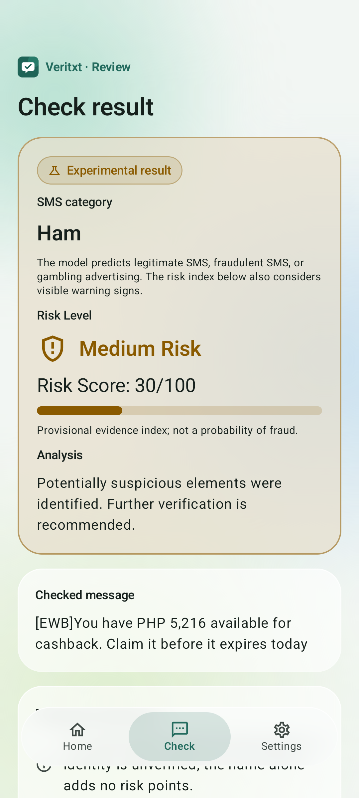

# VeriTxt cashback deadline review — 20 October 2026

The user requested all three SMS categories and Medium Risk for the supplied EastWest cashback message. A separate application profile now adds a targeted review cue. The three-class frozen SVM 60% model remains unchanged; it still predicts Ham for this example. The application displays **Ham / Medium Risk / Risk Score: 30/100**.

## Deliverable

- APK: `C:\Users\Jassim Trinidad\OneDrive\Desktop\smishguard\deliverables\cashback-review-20261020\VeriTxt-ThreeClass-CashbackReview-debug.apk`
- SHA-256: `974d1a67967d6ad2ea7ce73e866dd0abcb32261df6edbbaa22b3a98b0b6af910`
- Size: 22,172,945 bytes.
- Launcher: **VeriTxt · Cashback Review**.
- Package: `ph.smishguard.svm.cashbackreview`.
- Version: `0.3.0-cashback-review-debug`; clearly a debug build using the existing local debug signing configuration. APK v2 signature verified. No signing credentials were created or exposed.
- Minimum API 26; compile/target API 36. Runtime verification was performed on API 36 emulator only.

The APK installs alongside earlier builds. Open **Cashback Review** to use this profile. Existing APKs, datasets, fitted models and historical reports were preserved; 211 original files passed SHA-256 verification.

## Exact behavior change

Example:

> [EWB]You have PHP 5,216 available for cashback. Claim it before it expires today

| Output | Previous SVM 60% build | Cashback Review build |
| --- | --- | --- |
| Model category | Ham | Ham |
| Model weights / features | Frozen SVM 60% | Identical frozen SVM 60% |
| Added review indicator | None | Cashback claim with deadline |
| Risk score | 0/100 | 30/100 |
| Risk band | Low | Medium |

The proposed 30-point rule was described to the user before implementation. It requires nearby cashback/cash back/rebate wording, a claim/redeem/collect action and an explicit deadline such as expires today/tonight/soon, expires on, before midnight or within a stated number of hours/days/minutes. Matching is case-insensitive and whitespace-normalized; preceding negation/advice such as never, not, no need, avoid, huwag, wag and hindi suppresses the new cue. URL and email text is removed using the existing risk preprocessing before matching, so a URL path containing these words does not activate it.

No bank name, specific sender, account balance or PHP amount is hardcoded. Ordinary EastWest statements, credited-cashback receipts and cashback discussions without a positive time-limited claim remain outside the new cue. This is a caution rule; genuine promotional offers can also match it. The test message's authenticity was not independently established, and a Medium result is not proof of fraud.

The new indicator contributes 30 points once. Existing thresholds are unchanged: Low 0–29, Medium 30–69, High 70–100. Repetition cannot inflate the new indicator. Existing stronger evidence is never capped or downgraded: credential requests, model signals and other indicators can still produce High Risk. Automatic warning notifications remain limited to High Risk under the existing consent/permission gates; the new Medium result is displayed when checking a message. No alert threshold was changed.

The 0–100 score is a hand-defined provisional evidence index, not a fitted or calibrated fraud probability. The SVM margins remain separate raw multiclass values. This change neither forces a Smishing label nor alters the classifier's thresholds, vocabulary, IDF, coefficients or intercepts.

## Isolation and research integrity

The new `cashbackReview` build explicitly selects the frozen three-class SVM 60% from `research/runs/multiclass-20261020/run-v1/svm-60.pkl`: C=10, 30,227 features, classes Ham/Smishing/Gambling. Its pickle SHA-256 remains `73c996492889c846a396aba1b6f250eb3e488605104cb18c5318bb75c9dc605a`. The sole app asset is the unchanged 60% export, SHA-256 `3703fdb51583f090979ada04fc79201e58cbeb61b0a464cb6389b0baf5b07dd1`. The older binary APK model was not substituted because it cannot produce the Gambling class.

AppRiskPolicy chooses `cashback-claim-deadline-v1` only for this new build. The original RiskPolicy remains the default profile for older build variants; the new optional cue is disabled by default. Manual results, view-model updates and incoming-SMS assessment call the same application profile. Prior APK files themselves remain byte-identical. No experiment was retrained, no thesis test set was retuned against, and no historical metric or research conclusion was rewritten. Original risk source copies were saved privately for traceability.

The previous Python test accuracy is not an accuracy estimate for this revised combined application. A future independent labeled evaluation would be needed to estimate the heuristic's false-positive/negative rates. This targeted implementation follows the requested warning behavior; passing constructed tests is not population-level evidence.

## Verification

The final build assembled the application and test APKs, completed lint and executed unit tests successfully. Unit results: 44 passed, 13 conditional skips, zero failures/errors. Lint: 0 errors, 11 warnings. All three new unit tests executed. They cover the exact example, another bank/amount, alternative claim/deadline wording, routine statements, credited receipts, cashback conversations, incomplete trigger combinations, negated advice, URL-only wording, repeated claims and stronger credential requests.

Frozen model numerical parity on the JVM and actual Android runtime matched all 954/954 independent fixture labels, with maximum Android margin error 2e-15 and feature error 6.66e-16, against tolerance 1e-10. Both original models were additionally checked on the 20 practical messages: 40/40 predictions matched Python. That practical comparison retains the original baseline risk checks separately; new application risk behavior is explicitly recorded under `application_risk_profile` and `application_risk_rules_changed`.

The active application path matched the direct model on 948 fixtures. Native checks confirmed trainingPercent=60, the new risk profile, Ham as the unchanged cashback category and Medium/30 as its new application risk result. UI instrumentation checked the actual model, all three category displays, the exact EastWest message's Ham/Medium/30 display and the explanation indicator. A screenshot was captured from the tested final APK.

| Android instrumentation group | Tests | Result |
| --- | ---: | --- |
| native-parity | 1 | Passed |
| manual-three-categories | 2 | Passed |
| existing-flows | 6 | Passed |
| privacy-lifecycle | 2 | Passed |
| risk-results | 8 | Passed |
| theme-settings | 1 | Passed |
| real_model_incoming_sms | 1 | Passed |

Total: 21 tests passed on API 36. Existing manual/shared/pasted checks, privacy clearing, risk/blocking screens, theme settings and real emulator incoming-SMS High Risk warnings also passed. The normal non-test app process launched successfully. No crash occurred in those tested workflows. No physical-device/OEM/background or other Android-version test is claimed. Platform permissions remain RECEIVE_SMS and POST_NOTIFICATIONS; no new runtime permission or Internet access was added.

## Changed source and reproduction

New: CashbackDeadlineReview.kt, AppRiskPolicy.kt, CashbackReviewTest.kt, CashbackReviewAndroidTest.kt and CashbackReviewFlowTest.kt. Extended: RiskAssessment.kt (optional indicator), RiskPresentation.kt and three locale resource files (indicator explanation), CheckViewModel.kt/MainActivity.kt/IncomingSmsReceiver.kt (application profile routing), SmishGuardApp.kt (explicit existing 60% loader), and Gradle configuration (isolated build/asset checks). Model assets and mathematical scorer code were not changed for this rule.

New workflow scripts: build_cashback_review.ps1, verify_cashback_review.py, package_cashback_review.py and report_cashback_review.py. Private parity fixtures were copied to `research/runs/cashback-review-20261020/parity/` so older integration evidence is not overwritten.

```powershell
$env:PYTHONPATH='research'
.\scripts\build_cashback_review.ps1
research\.venv\Scripts\python.exe scripts/verify_cashback_review.py --output research/runs/cashback-review-20261020/NEW-VERIFICATION
```

Use fresh verification/package output paths. Packaging verifies the tested APK checksum, the unchanged source model and sole asset, final test/lint/signature evidence and preservation manifest before writing a fresh deliverable directory. To roll back, open/reinstall the preserved SVM 60% or SVM 80% APK rather than this new profile. Enable incoming scanning only in the intended version to avoid duplicate notifications from independently enabled side-by-side installations.

Known limits: the cue is a bounded English wording heuristic, not sender authentication or a reputation lookup. Paraphrases, different languages, quoted examples and genuine time-limited promotions can behave differently. Only the documented tests were performed, and Medium Risk requests independent verification rather than asserting fraud.


