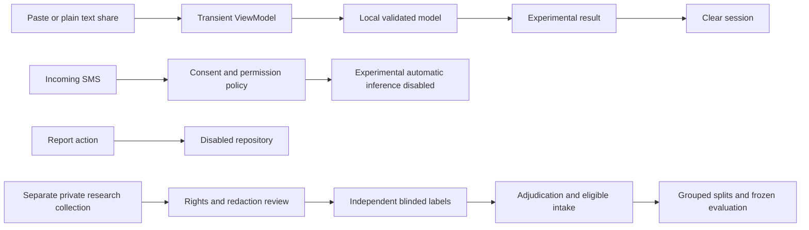

# Defense and demonstration materials

## Five minute system demonstration

0:00–0:40: Introduce the financial-impersonation task and explain that this is SmishGuard 0.2.0-dev with an experimental supplied model. State that research accuracy and calibration remain unverified.

0:40–1:30: Show onboarding, settings and the disabled automatic-warning/reporting state. Explain that manual checking does not require incoming-SMS permission. Use only a fictional message prepared by the team.

1:30–2:30: Paste a safe fictional English message, scan and explain the uncalibrated model score. Repeat with a fictional Taglish message; do not treat these examples as language-performance measurements or guaranteed classifications.

2:30–3:15: Share fictional plain text into SmishGuard. Show clearing after scan/navigation. Never open real inbox contents or a private annotation file during the demo.

3:15–4:00: Show airplane mode plus Wi-Fi off, repeat a manual scan and explain local model execution. Show that reporting is unavailable. Do not stage a synthetic notification as an actual model warning.

4:00–5:00: Show the verification and research-status tables. Disclose Xiaomi secure-FRP blockage, remaining human annotation and physical testing, and the next evidence gates. Stop with the stated research limitations rather than an unsupported accuracy claim.

## Ten to fifteen minute presentation outline

| Slide | Content | Approximate time |
|---|---|---|
| 1 | Problem, financial impersonation scope, O1–O5 | 1 min |
| 2 | Research gap with verified literature sources; qualify novelty | 1 min |
| 3 | Architecture and app/research data separation | 1 min |
| 4 | Supplied dataset audit versus eligible cohort | 1 min |
| 5 | Blinded annotation, redaction and adjudication | 1 min |
| 6 | Group splits, random comparison and shortcut controls | 1.5 min |
| 7 | Model selection, calibration, metrics and uncertainty | 1.5 min |
| 8 | Short offline manual demo or explicitly labeled recording | 2 min |
| 9 | Current software evidence and missing research results | 1 min |
| 10 | Limitations, FRP disclosure and client deliverable gaps | 1 min |
| 11 | Completion plan and bounded conclusions | 1 min |

This is repository-based slide content, not a generated final slide deck. Add actual evaluation figures only after valid artifacts exist.

## Architecture and data flow

Android uses one Activity, Compose, a transient ViewModel, local detector and a settings-only DataStore. No app scan feeds research collection. Research originals, coordinator mapping, responses and evaluation artifacts remain private. A future client dashboard has no active network path in this build.

Evaluation explanation: fit feature vocabulary and classifier only on training data; calibrate on a separate partition; choose threshold/model using validation; seal inputs/artifacts before one final evaluation. Keep every duplicate/near-template component together. Bootstrap components, not individual correlated copies. The supplied full-dataset export needs independently reviewed unseen confirmation, not a resplit of its training rows.

## Likely panel questions

| Question | Evidence based answer |
|---|---|
| What is the accuracy? | No defensible research accuracy is established. Software parity and fixture tests are different evidence; independent annotation and final evaluation remain pending. |
| Why LR? | It is the supplied experimental export, not a proven winner. The protocol still calls for LR/NB/SVM and two transformer comparisons. |
| Why not train on all 1,276 rows? | Eligibility, labels and provenance are unresolved; 70 UCI rows remain supplementary and nonfinancial records cannot silently become negatives. |
| Does 0.9 mean 90% fraud probability? | No. The supplied score is uncalibrated. Threshold 0.5 is provisional and automatic warnings are disabled. |
| Do sources prove permission? | Content matches identify candidate overlap, not acquisition lineage or blanket rights. Record-specific use and redistribution review are separate. |
| Why no phone demonstration? | The target Xiaomi reports secure_frp_mode=1 despite completed setup flags and restart. Installation is blocked by device state pending Xiaomi support. Emulator tests do not replace hardware validation. |
| Does the app collect or send SMS? | This build has no INTERNET permission or enabled reporting path. Scan text is transient; the external keyboard/clipboard/SMS app is outside this app's storage boundary. |
| Where is the dashboard? | It remains an explicit unfulfilled client requirement; contract/governance and implementation are pending. We have not silently removed it. |
| Can others reproduce it? | Public code, tests and sanitized artifacts are reproducible; supplied model and private data need authorized controlled access. Exact hashes and commands are recorded. |

## Limitations slide and fallback

Use these points verbatim as limitations: unverified inherited labels; no real-world performance or calibrated warning approval; incomplete source/redistribution review; limited language/source coverage; no current physical-device validation; unfinished collection form and dashboard.

Fallback: use the dedicated API36 emulator and current saved test records. Historical empty-screen screenshots in `docs/screenshots/` may illustrate UI only and must be labeled historical. A fresh safe-screen recording may be captured by the team before defense; no recording is claimed to exist here. Verify its APK hash/date and use fictional text, hide system notifications and private paths, and label playback clearly. If no safe recording exists, use the architecture diagram and test artifacts; never simulate a successful physical install.
