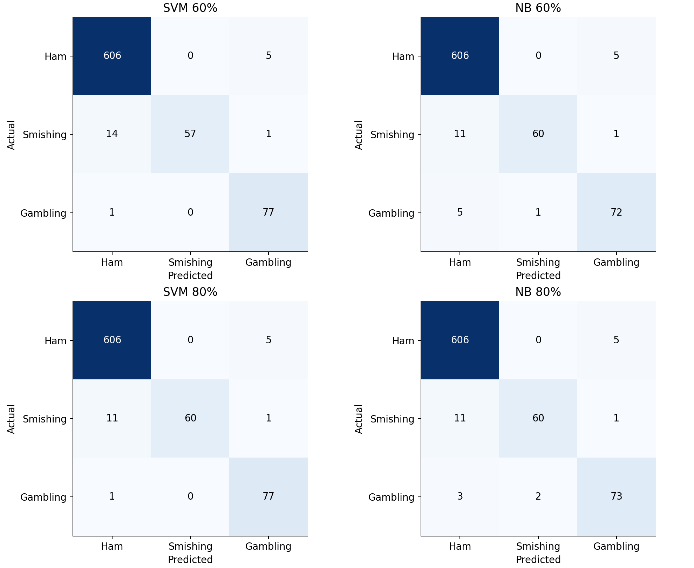
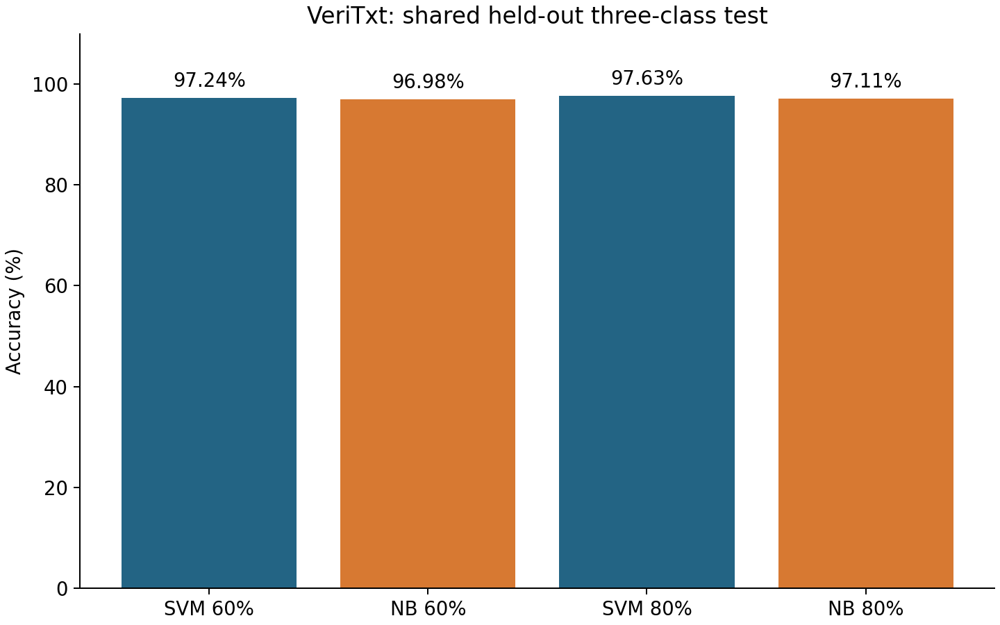
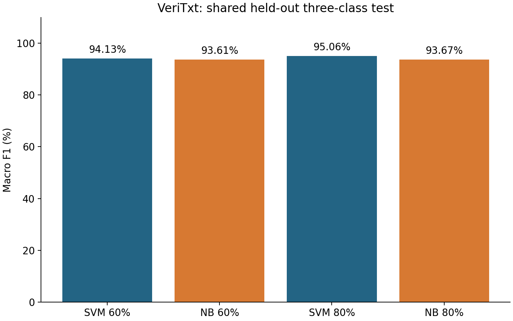
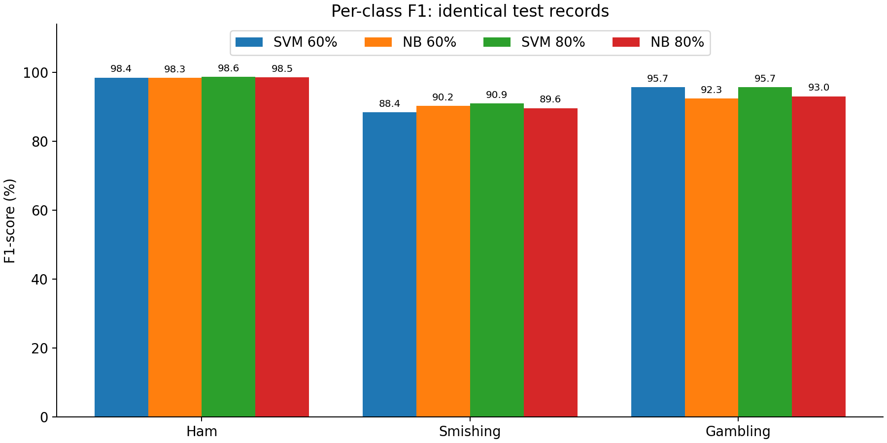

# VeriTxt: controlled Linear SVM versus Multinomial Naive Bayes

Completed 20 October 2026. All metrics below are measured from the frozen run, not copied from historical reports. Percentages are rounded to two decimals; machine-readable files retain full precision.

**Conclusion:** Linear SVM has the higher observed 80% test macro F1, but the difference is uncertain. It is a provisional research preference, not statistically established general superiority or approval to change the Android model.

## Project inspection and changes

The inspection covered the repository and research READMEs; the October 12 dataset ZIP and CSV schema; existing `nb_comparison.py`, `holdout_8020.py`, `all_algorithms_8020.py`, `retraining.py`, `new_dataset_compare.py`, `data.py` and `preprocessing.py`; saved prior-run configuration/selection manifests and model-folder inventory; October 16/19 evaluation and generalization reports; supplied model-evidence evaluation notes; dependency pins; and existing research integrity tests. No bundled dataset script was executed and no prior model was reused for inference in this comparison.

Recent NB training used five alpha settings and a LinearSVC(C=1) reference on binary Ham/Smishing labels. Gambling was excluded. The validation run selected by smishing F1; the 80/20 run used pooled three-fold training OOF smishing F1. Historical A–E training additionally varied feature families, classifier parameters, class weights, calibration and validation thresholds. These outcomes do not isolate the requested three-class algorithm comparison. Older supplied scripts also cross-validated an already-vectorized matrix; their inner vocabulary/IDF leakage is documented in `research/model_evidence/MODEL_EVALUATION.md`.

Existing evaluation problems include different eligible records/features/test sets/selection rules, inaccurate nominal split percentages, conservative sender components of very unequal sizes, source-label confounding, inherited rule-generated labels and historical exposure. A previous requested 70/15/15 split realized approximately 46/23/31; another 80/20 test contained nine components. Neither historical winner is assumed correct here.

Added a dedicated modular comparison module, pinned comparison requirements, synthetic integrity tests, a reporting script, a prespecified protocol, and the aggregate files in this directory. The existing normalization, TF-IDF feature settings and grouping implementation were reused unchanged. All new models, SMS-bearing ledgers and predictions stay under the ignored private run directory. Android code, APK integration, existing models and historical reports were preserved.

## Dataset audit

| Class | Original records | Eligible records | Eligible share (%) |
| --- | --- | --- | --- |
| Ham | 3184 | 3055 | 80.33 |
| Smishing | 577 | 363 | 9.55 |
| Gambling | 500 | 385 | 10.12 |

Original N=4261; analysis N=3803; excluded=458. The analysis uses the existing three Kaggle sources. There are 397 source-held records and 118 review-flagged records; reasons overlap and must not be summed to obtain the exclusion total. This is a controlled eligible subset, not a claim to evaluate all 4,261 original records.

| Class | Excluded total | Source hold | Review flag |
| --- | --- | --- | --- |
| Ham | 129 | 108 | 35 |
| Smishing | 214 | 174 | 83 |
| Gambling | 115 | 115 | 0 |

Raw exact duplicate extra rows=0; whitespace/casefold duplicate extra rows=0; conflicting exact-label groups=0. Supplied template identities=2854; computed connected components=658; multirow components=154; mixed-label components=2. Multirow components can represent sender links as well as near-copy templates, so they are not a count of duplicate texts. The two mixed-label components stay intact and are not relabeled. Largest corpus components: 606, 466, 417, 148, 132, 97, 89, 85, 84, 62 records. Source labels, human review and privacy status are not independently established by this audit.

### Shared partitions

| Partition | Records | Ham | Smishing | Gambling | Groups | Corpus share (%) |
| --- | --- | --- | --- | --- | --- | --- |
| train60 | 2281 | 1833 | 218 | 230 | 395 | 59.98 |
| validation20 | 761 | 611 | 73 | 77 | 131 | 20.01 |
| test20 | 761 | 611 | 72 | 78 | 132 | 20.01 |
| train80 | 3042 | 2444 | 291 | 307 | 526 | 79.99 |

The 60% training records are an exact subset of 80% training. Validation is the difference. The 761 test messages are identical and in the same order for all four configurations. All three pairwise overlap audits report zero shared row indices, zero normalized exact texts and zero computed groups. Group links include every supplied template identity. All five CV train/validation pairs also pass these checks and exclude the final test set. Class counts differ from proportional targets by less than one record.

| Partition | Groups | Largest group | Largest group share (%) |
| --- | --- | --- | --- |
| train60 | 395 | 606 | 26.57 |
| validation20 | 131 | 466 | 61.24 |
| test20 | 132 | 417 | 54.80 |
| train80 | 526 | 606 | 19.92 |

Full source/language counts are in `source-language-distribution.csv`; fold supports are in `cv-partitions.csv`. The largest test group contains 417/761 messages (54.80%); the largest validation group contains 466/761 (61.24%). The Chua marketing source contributes 616/761 test messages (80.95%), while Tagalog-SMS contributes 2,235/3,042 training messages (73.47%). Thus balancing row/class/group counts has not removed source or component-size concentration. The number of test components is not a guarantee of representative independent campaigns. Group-aware separation addresses the declared exact/near-template criteria; it cannot prove all latent campaigns or paraphrases are independent.

## Thesis-ready methodology

A controlled retrospective experiment compared Linear Support Vector Machine (LinearSVC) and Multinomial Naive Bayes for three-class SMS classification: Ham, Smishing and Gambling. The original dataset contained 4,261 records. Applying the existing source scope, review flags, text validity checks and duplicate/conflict rules produced 3,803 eligible records: 3,055 Ham, 363 Smishing and 385 Gambling. Labels were inherited from the supplied corpus and were not independently reannotated in this experiment. Gambling advertisements were mapped explicitly to class 2; gambling-related fraudulent lures retained their supplied Smishing label.

Related records were joined using existing template-group identifiers, available source-scoped sender/campaign/conversation identifiers, and Unicode template similarity at a SequenceMatcher ratio of at least 0.85 after URL and number removal. Connected components were indivisible. Grouping was label-blind and used full-corpus text only to establish separation, not to estimate vectorization features. A seeded integer allocator jointly assigned 2,281 records to training, 761 to validation and 761 to testing while enforcing proportional class counts to whole-record precision and balancing class-associated group counts. The 80% training condition used the union of training and validation, containing 3,042 records. The shared test portion contained 611 Ham, 72 Smishing and 78 Gambling records across 132 components. Random seed 42 and the exact membership manifests were retained.

For both classifiers, whitespace-normalized messages were transformed using the same word-unigram/bigram TF-IDF representation with lowercase Unicode tokenization, preserved URL/number/currency tokens, a shared conservative 13-word English stopword list, minimum document frequency 1, no feature cap, raw term frequency, smoothed inverse document frequency and L2 normalization. No stemming, translation, resampling, class weighting, calibration or threshold optimization was applied. Vectorization and classification were combined in a scikit-learn Pipeline. Every candidate fit learned its vocabulary and IDF only from its corresponding fitting records; no validation or test message contributed to these learned quantities.

The LinearSVC search considered C={0.001,0.01,0.1,1,10,100,1000}, with dual=auto, max_iter=20000 and seed 42. The MultinomialNB search considered alpha={0.001,0.01,0.1,0.5,1,2,10}, using empirical class priors. In the 60% condition, the setting with the highest macro F1 on the separate validation portion was selected and fitted on the same 60% training records without including validation messages. In the 80% condition, both classifiers shared five deterministic stratified group folds within the 80% training portion; parameters maximized the mean fold macro F1. Exact score ties preferred the smaller parameter. Selected 80% pipelines were refitted on all 3,042 training records. The five-fold mean and population standard deviation were reported as tuning summaries, not as independent final generalization estimates.

After tuning, input identities, memberships, source hashes, parameter selections and fitted artifacts were sealed. A separate evaluation stage transformed the test messages once for each prespecified model. Multiclass predictions used native classifier decisions. Evaluation recorded accuracy, macro precision, macro recall, macro F1, weighted F1, class-specific precision/recall/F1/support, actual-by-predicted confusion matrices and counts of safety-relevant errors. Macro F1 was the primary comparison metric because it gives equal weight to the three imbalanced classes; Smishing recall was examined separately. All reported final metrics were recomputed from saved predictions. Two thousand paired whole-component bootstrap replicates with seed 42 provided conditional descriptive percentile intervals for macro F1 differences. These intervals do not account for model-training, annotation or corpus-selection uncertainty.

The 60% versus 80% contrast compares the requested training regimes, including their different tuning procedures. It does not isolate sample size as the sole cause of a performance change. Since this corpus had already influenced earlier experiments, test messages were held out from this run but were not prospectively unseen. No model was installed in the application.

## Measured comparison tables

All score columns below are percentages. CV SD is measured in percentage points. N/A means single-validation selection, not a missing CV run.

### 60% training

| Model | Accuracy | Macro P | Macro R | Macro F1 | Weighted F1 | Correct | Errors |
| --- | --- | --- | --- | --- | --- | --- | --- |
| svm-60 | 97.24 | 96.79 | 92.36 | 94.13 | 97.15 | 740 | 21 |
| nb-60 | 96.98 | 96.03 | 91.61 | 93.61 | 96.92 | 738 | 23 |

### 80% training

| Model | Accuracy | Macro P | Macro R | Macro F1 | Weighted F1 | Correct | Errors |
| --- | --- | --- | --- | --- | --- | --- | --- |
| svm-80 | 97.63 | 96.94 | 93.74 | 95.06 | 97.58 | 743 | 18 |
| nb-80 | 97.11 | 95.64 | 92.03 | 93.67 | 97.05 | 739 | 22 |

### Combined comparison

| Model | Accuracy | Macro P | Macro R | Macro F1 | Weighted F1 | Correct | Errors |
| --- | --- | --- | --- | --- | --- | --- | --- |
| svm-60 | 97.24 | 96.79 | 92.36 | 94.13 | 97.15 | 740 | 21 |
| nb-60 | 96.98 | 96.03 | 91.61 | 93.61 | 96.92 | 738 | 23 |
| svm-80 | 97.63 | 96.94 | 93.74 | 95.06 | 97.58 | 743 | 18 |
| nb-80 | 97.11 | 95.64 | 92.03 | 93.67 | 97.05 | 739 | 22 |

### Per-class results

| Model | Class | Precision | Recall | F1 | Support |
| --- | --- | --- | --- | --- | --- |
| svm-60 | Ham | 97.58 | 99.18 | 98.38 | 611 |
| svm-60 | Smishing | 100.00 | 79.17 | 88.37 | 72 |
| svm-60 | Gambling | 92.77 | 98.72 | 95.65 | 78 |
| nb-60 | Ham | 97.43 | 99.18 | 98.30 | 611 |
| nb-60 | Smishing | 98.36 | 83.33 | 90.23 | 72 |
| nb-60 | Gambling | 92.31 | 92.31 | 92.31 | 78 |
| svm-80 | Ham | 98.06 | 99.18 | 98.62 | 611 |
| svm-80 | Smishing | 100.00 | 83.33 | 90.91 | 72 |
| svm-80 | Gambling | 92.77 | 98.72 | 95.65 | 78 |
| nb-80 | Ham | 97.74 | 99.18 | 98.46 | 611 |
| nb-80 | Smishing | 96.77 | 83.33 | 89.55 | 72 |
| nb-80 | Gambling | 92.41 | 93.59 | 92.99 | 78 |

### Error counts

| Model | Smishing → Ham | Gambling → Ham | Ham → Smishing | Ham → Gambling |
| --- | --- | --- | --- | --- |
| svm-60 | 14 | 1 | 0 | 5 |
| nb-60 | 11 | 5 | 0 | 5 |
| svm-80 | 11 | 1 | 0 | 5 |
| nb-80 | 11 | 3 | 0 | 5 |

The two dangerous-to-Ham counts do not include Smishing predicted Gambling. Each selected 80% model additionally assigned one Smishing message to Gambling; both detected 60/72 as Smishing and missed 12/72 for that class. Both mislabeled five legitimate messages as Gambling and none as Smishing on this test; zero observed errors in a cell does not imply zero population risk.

### Hyperparameters and cross-validation

| Model | Selected parameter | Validation macro F1 | CV mean macro F1 | CV SD |
| --- | --- | --- | --- | --- |
| svm-60 | C=10.0 | 86.06 | N/A | N/A |
| nb-60 | alpha=0.01 | 88.95 | N/A | N/A |
| svm-80 | C=10.0 | N/A | 88.74 | 6.34 |
| nb-80 | alpha=0.01 | N/A | 89.56 | 3.83 |

| 80% model | Fold 1 | Fold 2 | Fold 3 | Fold 4 | Fold 5 | Mean | SD |
| --- | --- | --- | --- | --- | --- | --- | --- |
| svm-80 | 79.20 | 94.19 | 94.06 | 83.06 | 93.17 | 88.74 | 6.34 |
| nb-80 | 87.85 | 88.68 | 95.17 | 83.97 | 92.15 | 89.56 | 3.83 |

The full seven-setting search for each algorithm is in `cross-validation.csv` (14 rows), and all 60% validation plus 80% CV searches are in `tuning-all.csv` (28 rows). SD uses ddof=0. Fold fitting sets overlap, so SD is not an independent-sample standard error. NB has 0.82 percentage points higher tuning CV mean and lower fold variability, although SVM has the higher final test macro F1. This disagreement is evidence against treating one split as a stable universal ordering.

### Confusion matrices

Rows are actual classes; columns are predictions. Order: Ham, Smishing, Gambling.

svm-60

| Actual / predicted | Ham | Smishing | Gambling |
| --- | --- | --- | --- |
| Ham | 606 | 0 | 5 |
| Smishing | 14 | 57 | 1 |
| Gambling | 1 | 0 | 77 |

nb-60

| Actual / predicted | Ham | Smishing | Gambling |
| --- | --- | --- | --- |
| Ham | 606 | 0 | 5 |
| Smishing | 11 | 60 | 1 |
| Gambling | 5 | 1 | 72 |

svm-80

| Actual / predicted | Ham | Smishing | Gambling |
| --- | --- | --- | --- |
| Ham | 606 | 0 | 5 |
| Smishing | 11 | 60 | 1 |
| Gambling | 1 | 0 | 77 |

nb-80

| Actual / predicted | Ham | Smishing | Gambling |
| --- | --- | --- | --- |
| Ham | 606 | 0 | 5 |
| Smishing | 11 | 60 | 1 |
| Gambling | 3 | 2 | 73 |









### Paired uncertainty

| Macro F1 contrast | Difference (pp) | Conditional 95% interval (pp) | Valid replicates |
| --- | --- | --- | --- |
| svm-80 minus nb-80 | 1.39 | [-0.67, 4.24] | 2000 |
| svm-60 minus nb-60 | 0.52 | [-2.52, 2.94] | 2000 |
| svm-80 minus svm-60 | 0.93 | [-1.15, 4.20] | 2000 |
| nb-80 minus nb-60 | 0.06 | [-2.02, 2.08] | 2000 |

All intervals include zero. Whole test components, rather than individual messages, are resampled because messages within a component can be dependent. These are conditional fixed-prediction intervals from 132 observed components; grouping errors, historical exposure and unseen sources remain outside their scope. They do not demonstrate a statistically proven winner.

## Thesis-ready results and discussion

Under the primary controlled 80/20 comparison, Linear SVM obtained 97.63% accuracy, 96.94% macro precision, 93.74% macro recall, 95.06% macro F1 and 97.58% weighted F1. Multinomial Naive Bayes obtained 97.11% accuracy, 95.64% macro precision, 92.03% macro recall, 93.67% macro F1 and 97.05% weighted F1. Linear SVM therefore had a 1.39-percentage-point macro F1 advantage and a 0.53-percentage-point accuracy advantage, correctly classifying 743 rather than 739 of the same 761 messages. These are observed differences from one retrospectively constructed test partition.

Both 80% models detected 60 of 72 Smishing records, yielding 83.33% Smishing recall. Each incorrectly assigned 11 Smishing messages to Ham and one to Gambling. Linear SVM had 100.00% Smishing precision compared with 96.77% for Naive Bayes because Naive Bayes additionally assigned two Gambling messages to Smishing. Linear SVM correctly identified 77 of 78 Gambling messages, whereas Naive Bayes identified 73 of 78. Ham recall was identical at 606/611, or 99.18%. Thus the observed overall SVM advantage was associated mainly with fewer Gambling-class mistakes and higher Smishing precision, rather than higher Smishing recall. Since Ham accounts for 80.33% of the eligible corpus, accuracy alone would conceal a meaningful minority-class miss rate.

The algorithms respond differently to sparse TF-IDF features: Linear SVM learns discriminative margins, whereas Multinomial Naive Bayes estimates class-conditional feature evidence with smoothing. Correlated unigram/bigram evidence and different class boundaries are plausible explanations for the observed differences, but this experiment did not isolate these mechanisms. The defensible empirical explanation is the confusion-matrix pattern, not a demonstrated causal property or a claim that either algorithm is always superior. TF-IDF is a common shared representation here; this experiment does not establish superiority under count features, alternative feature families or independent datasets.

At 60% training, Linear SVM achieved 94.13% macro F1 and 97.24% accuracy, while Naive Bayes achieved 93.61% macro F1 and 96.98% accuracy. Naive Bayes had higher Smishing recall in that condition (83.33% versus 79.17%), while SVM performed better on Gambling. Increasing the fitting portion to 80% raised SVM macro F1 by 0.93 percentage points and accuracy by 0.39 points, reducing errors from 21 to 18. Its Smishing recall increased by 4.17 points. Naive Bayes macro F1 increased by only 0.06 points and accuracy by 0.13 points, reducing errors from 23 to 22; Smishing recall remained unchanged. Both regimes selected C=10 for SVM and alpha=0.01 for NB. The regimes used different tuning procedures, so these changes cannot be attributed solely to the number of fitting messages.

Uncertainty limits the recommendation. Naive Bayes had a higher five-fold tuning macro F1 (89.56% ± 3.83 percentage points population SD) than SVM (88.74% ± 6.34). The paired whole-group bootstrap interval for the 80% test macro F1 difference, SVM minus NB, was −0.67 to +4.24 percentage points and included zero. The corresponding intervals for increasing training size also included zero. The test results therefore support a provisional preference for SVM while remaining compatible with negligible or reversed differences in other samples. No significance claim follows from the point estimates or CV standard deviations.

Additional limitations include class imbalance, inherited source/rule labels, uneven source representation, only one outer allocation, heuristic/transitive grouping, potentially broad sender components and prior corpus exposure. Gambling and Smishing are evaluated according to supplied labels; ambiguous gambling-related fraud requires independent annotation. Although the new allocation distributes 132 test components and preserves all declared groups, it is not a test of future campaign, source, language or temporal transfer. Independent adjudicated SMS collected after this protocol, with preserved campaign groups and explicit deployment criteria for Smishing recall, are needed before making operational reliability claims.

## Research question answers and recommendation

**RQ1 — Identical-condition performance.** At 80% training, Linear SVM has the higher observed macro F1: 95.06% versus 93.67% (+1.39 pp). The conditional interval includes zero, and NB leads in tuning CV; superiority is inconclusive beyond this split.

**RQ2 — Effect of training regime.** SVM gains +0.93 pp macro F1 from 60% to 80%; NB gains +0.06 pp. Accuracy gains are +0.39 and +0.13 pp, respectively. These describe the requested size-and-tuning regimes, with uncertain differences; they are not a causal learning curve.

**RQ3 — Balance across classes.** On the primary test, SVM has the stronger macro precision/recall/F1 balance. Its Ham, Smishing and Gambling F1 values are 98.62%, 90.91% and 95.65%, versus 98.46%, 89.55% and 92.99% for NB. Smishing recall remains tied at 83.33%. At 60%, NB offers better Smishing recall despite lower macro F1, so the tradeoff depends on training regime.

**RQ4 — Suitability for VeriTxt.** Use LinearSVC(C=10) with the documented TF-IDF pipeline as the provisional research candidate, based on the prespecified primary 80% comparison. Keep MultinomialNB(alpha=0.01) as a competitive baseline. Both miss 12/72 Smishing labels on this test; the observed metrics do not establish sufficient real-world fraud protection. Confirm the preference on independently annotated, prospectively reserved campaigns. No Android integration or APK change was performed.

## Reproduction and artifact guide

See [PROTOCOL.md](PROTOCOL.md) for precise policies and commands. Run from the repository root in PowerShell with a fresh output directory:

```powershell
research\.venv\Scripts\python.exe -m pip install -r research\multiclass-comparison-requirements.txt
$env:PYTHONPATH='research'
research\.venv\Scripts\python.exe -m unittest research.tests.test_multiclass_comparison -v
research\.venv\Scripts\python.exe -m smishguard.multiclass_comparison run research/runs/multiclass-20261020/NEW-RUN --dataset research/data/newdata-20261013/smishguard_dataset_2026-10-12.zip --report-dir docs/multiclass-comparison-20261020/NEW-REPORT
research\.venv\Scripts\python.exe scripts/report_multiclass_comparison.py research/runs/multiclass-20261020/NEW-RUN docs/multiclass-comparison-20261020/NEW-REPORT
```

Completed private run: `research/runs/multiclass-20261020/run-v1`. It contains original input hashes, normalized dataset, exclusions, exact split/CV membership, code snapshots, environment, tuning scores, four fitted pipelines, selections, predictions and seals. Reproduction requires the locally retained original ZIP; the public Git repository intentionally omits it. Reporting can be repeated from the frozen run without fitting or reevaluating test messages.

Files: dataset-distribution.csv, partitions.csv, exclusions.csv, group-distribution.csv, source-language-distribution.csv, cv-partitions.csv, comparison-60.csv, comparison-80.csv, comparison-all.csv, per-class.csv, cross-validation.csv, tuning-all.csv, four confusion CSVs/PNGs, combined confusion PNG, accuracy.png, macro_f1.png, per-class-f1.png, results.json and uncertainty.json. CSV scores are fractions from 0 to 1; tables and figures use percentages.

Runtime versions: numpy 2.2.6, scipy 1.15.3, scikit-learn 1.6.1, pandas 2.3.3, matplotlib 3.10.7, joblib 1.6.0, threadpoolctl 3.7.0. Python 3.12.5. The solver reported an optimal allocation with relative gap 0.0. Exact saved memberships are authoritative; equivalent solver ties can differ across numerical-library versions.

Method references: [scikit-learn leakage prevention](https://scikit-learn.org/stable/common_pitfalls.html#data-leakage) and [grouped cross-validation](https://scikit-learn.org/stable/modules/cross_validation.html#cross-validation-iterators-for-grouped-data). Pipelines keep learned transforms within fitting subsets; group-aware splitting still cannot guarantee perfect stratification with large indivisible groups.
