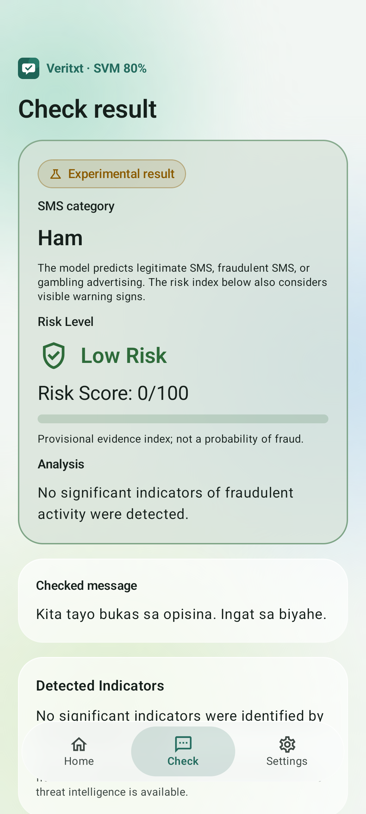
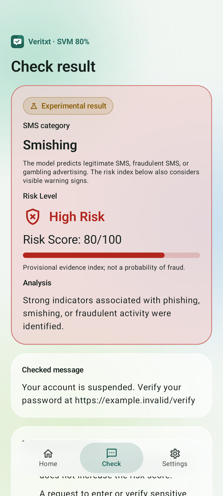
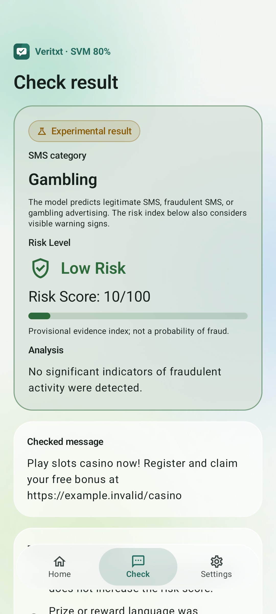

# VeriTxt Linear SVM 80% Android integration — 20 October 2026

The separate debug APK was built, its packaged model and signature verified, and its actual model inference and app workflows tested on an Android API 36 emulator. This report concerns software integration; it does not estimate new SMS classification accuracy.

## APK and preservation

- APK: `C:\Users\Jassim Trinidad\OneDrive\Desktop\smishguard\deliverables\multiclass-svm-80-20261020\VeriTxt-LinearSVM-80-New-debug.apk`
- Size: 22,451,611 bytes.
- SHA-256: `e31e440d1e02512b0cf2718cde2fcf87e3f7cc9de944eb0fe5e8ad1dcfd0d8ec`.
- Application ID: `ph.smishguard.svm.multiclass80`; namespace remains `ph.smishguard`.
- Launcher label: `VeriTxt · SVM 80%`; version: `0.3.0-svm80-debug`.
- Minimum Android: 8.0 / API 26; target/compile API 36.
- Build type: `multiclassSvm`, initialized from the existing debug configuration. The existing local debug signing key was reused. APK Signature Scheme v2 verification passed; no release signing credentials were created, exposed or embedded.

The distinct application ID suffix allows side-by-side installation without replacing an existing VeriTxt installation or its settings. Old build types, classifier assets and historical APK files were retained. SHA-256 checks verified all 119 files in the preservation manifest, including the frozen study directory, original dataset ZIP, original results/figures/protocol, prior model assets and prior APK outputs. No training or thesis evaluation was executed. No original research documentation was edited.

## Source model and exact export

Source artifact: `C:\Users\Jassim Trinidad\OneDrive\Desktop\smishguard\research\runs\multiclass-20261020\run-v1\svm-80.pkl`. Experiment: `multiclass-20261020/run-v1`; selection ID: `svm-80`; LinearSVC C=10, trained on 3,042 records. The original frozen evaluation involved 761 records. Source pickle SHA-256: `957fe1ef05885a81d909c495d23a06487908c07b891f204109fdd13b474f8104`. Training-seal SHA-256: `9697592b46250599e28c692e5dc4c9b74498092dd7630ef68a7b8449b646bc69`.

Inspection checked selection.json, configuration.json, environment.json, training-seal.json, the thesis report/protocol, fitted pipeline properties and the existing Android inference architecture. The original study seal was verified before export and after packaging. The selected object has 37,885 features, a 3×37,885 coefficient matrix, three intercepts and class order [0,1,2].

| Class index | Category |
| --- | --- |
| 0 | Ham — legitimate SMS |
| 1 | Smishing — fraudulent SMS |
| 2 | Gambling — gambling-related advertising |

The existing selected-SVM scorer is binary, uses a masking adapter and a different tokenizer/stopword/calibration contract; the other recently integrated NB scorer is also binary. Those scorers cannot faithfully interpret this model. A dedicated Kotlin scorer was therefore added. The algorithm, representation and fitted parameters were preserved; no alternative estimator, ONNX approximation, new fitting, probability conversion, calibration or threshold was introduced.

`scripts/export_multiclass_svm_android.py` loads only the verified selected pickle and exports an ordered vocabulary, full-precision IDF, all three coefficient rows, intercepts, Unicode tables and explicit metadata. Every exported numeric array was checked for exact equality after JSON serialization. The export's independent linear calculation differed from scikit-learn by at most 2.22e-15. The model asset is 4,508,236 bytes, within the app's existing 8 MB loader limit.

Export model SHA-256: `ba6fc0bf7f32cd4405402534fdda408eed418072279928958ae4ba88c83894d6`. It is the APK's sole asset, `assets/model.json`. No pickle, dataset, raw corpus records, parity fixture, prior model asset or raw-SMS masking adapter is packaged. Gradle checks the pinned asset hash before building; the app checks it again before loading. Metadata checks reject wrong versions, classes, dimensions and preprocessing contracts. A failed check produces the existing invalid-model state, never a fallback to an older classifier.

## TF-IDF and multiclass decision implementation

Whitespace is collapsed with the original Python Unicode whitespace set, then text is lowercased using frozen Unicode 15.0 tables, including expanding lowercase mappings and context-sensitive Greek final sigma. Java/Android's own Unicode version and regex defaults are not used as substitutes for the trained tokenization.

The original token pattern is preserved:

```text
(?u)https?://[^\s<>]+|www\.[^\s<>]+|[₱$€£]\s?\d+(?:[,.]\d+)*|\b\d+(?:[,.]\d+)*\b|\b\w+\b
```

URL and currency alternatives retain their original priority; numeric backtracking and Unicode word boundaries are reproduced. The shared 13 conservative English stopwords are removed before adjacent bigrams. Unknown tokens remain in adjacency while forming features. Word unigrams and bigrams use the exported feature indices; raw counts are multiplied by the unchanged learned IDF and L2-normalized. Empty feature vectors retain zero features and therefore score using the intercepts. There is no accent stripping, stemming, translation, identifier masking, feature cap, new stopword policy or truncation in the mathematical scorer.

Each class margin equals its intercept plus the TF-IDF/weight dot product. The category is the largest raw one-versus-rest margin. Exact score ties select the first class in [0,1,2], as numpy.argmax does; negative winning margins are valid. Margins are not probabilities. The original three-class model has no binary classification threshold, and none was added.

The scorer's mathematical path handles empty strings and unknown features consistently with Python. Application input boundaries remain explicit: blank input is shown as Unable to assess; malformed NUL/unpaired-surrogate input and messages exceeding the existing 10,000 UTF-16-unit app limit are rejected. Standalone phone numbers, URLs and email addresses retain the app's existing Unable-to-assess handling instead of acquiring an identity/reputation verdict. These wrapper states are tested separately from the mathematical class/margin comparison. They are not retuning or replacement model predictions.

## Application routing and retained behavior

The `multiclassSvm` variant selects `MulticlassSvmDetector` in SmishGuardApp. That same cached detector serves manual checks, shared/pasted SMS, checks opened from notifications and incoming-SMS assessment. The model is immutable; only model parameters are cached. App-path tests verified the detector's actual runtime type, so an older SVM/NB model cannot accidentally satisfy the test.

Detection.Success now carries an optional SMS category and three raw margins. Existing binary variants leave these fields absent. The new result screen displays Ham, Smishing or Gambling and explains the three-class decision in the details dialog. Existing Low/Medium/High risk scores remain the existing rule-based evidence index and are presented separately. The Smishing category supplies the existing model-signal indicator; Gambling is not silently mapped to Smishing. Risk thresholds and warning logic were not changed.

Existing privacy acceptance, scanning opt-in, notification permission gates, settings, themes, language handling, message sharing, clear/session behavior, Android blocking handoff and disabled reporting remain. The platform permissions are still RECEIVE_SMS and POST_NOTIFICATIONS; no READ_SMS, INTERNET or other new Android runtime permission was added. The AndroidX-generated signature permission has the new package prefix, as it does for other side-by-side variants.

The existing app has opt-in incoming-SMS assessment and manual checks; it does not implement a persisted SMS inbox/history database or bulk historical inbox scanner. This integration does not invent those features or add storage permissions. Transient messages are still cleared on existing navigation/lifecycle boundaries. Automatic warnings remain gated by the existing risk policy and user controls; they are not a new model approval claim.

## Python-to-JVM/Android consistency

Fixtures were independent synthetic inputs and vocabulary-derived numerical stress probes, separate from the thesis SMS test set. No reserved thesis message was transformed, selected, fitted or retuned against. Cases cover legitimate examples, fraudulent lures, gambling advertising, English, Filipino, Taglish, URLs, phone numbers, currency, short/long/ambiguous messages, Unicode lowercase/whitespace/boundary edge cases, empty input, all vocabulary terms and 400 deterministic randomized tokenizer probes. Expected terms, sparse TF-IDF features, all three margins and labels came from the frozen Python pipeline.

| Check | JVM | Android API 36 |
| --- | ---: | ---: |
| Mathematical cases | 1062 | 1062 |
| Matching labels | 1062 | 1062 |
| Label mismatches | 0 | 0 |
| Maximum margin error | 2.44e-15 | 2.44e-15 |
| Maximum TF-IDF error | 1.67e-15 | 1.67e-15 |
| Absolute tolerance | 1e-10 | 1e-10 |

The Android app's normal assessment path additionally matched the direct scorer on 1056 eligible fixtures. Wrapper checks recorded 1058 direct detector successes, 2 blank abstentions and 2 invalid/over-limit rejections. Explicit tie behavior, negative margins, all three category indices and incompatible export rejection were also tested. These counts describe parity and interface handling, not semantic ground-truth accuracy.

## Build and runtime verification

The final Gradle build completed successfully: assembleMulticlassSvm, lintMulticlassSvm, testMulticlassSvmUnitTest and assembleMulticlassSvmAndroidTest. Lint: 0 errors and 11 warnings. Host unit tests: 40 passed, 11 skipped for other/private model configurations, 0 failures and 0 errors. Both new multiclass unit tests executed and passed. Build logs and lint output identify the remaining warnings; no warning was presented as a passed test.

The exact final APK was installed on a verified API 36 emulator. Numerical parity ran with airplane mode enabled and no INTERNET permission. The modem test enabled the emulator's cellular radio and used console-injected fictional SMS; no carrier or physical phone was used. The runner restored prior network settings afterward.

| Instrumentation group | Tests | Result |
| --- | ---: | --- |
| native-parity | 1 | Passed |
| manual-three-categories | 1 | Passed |
| existing-flows | 6 | Passed |
| privacy-lifecycle | 2 | Passed |
| risk-results | 8 | Passed |
| theme-settings | 1 | Passed |
| real_model_incoming_sms | 1 | Passed |

Total instrumentation tests: 20. The manual UI test verified all three categories using the actual bundled classifier. The real modem test verified incoming SMS assessment, an automatic High Risk notification and opening its result using the actual classifier. Existing flow tests checked shared/pasted inputs, denied permissions, navigation, missing/invalid models and clear behavior; privacy tests checked message disposal; risk tests checked the existing result/Android blocking handoff; theme tests checked rendered colors, settings and activity recreation. The normal non-test Application process was launched successfully after instrumentation. No crash occurred in these tested workflows.

During harness development, an incoming-SMS check failed because airplane mode was still enabled. The harness was corrected to enable the emulator radio for SMS delivery, and the final APK's verification reran with the corrected setup. Neither model parameters nor classification rules changed to pass it. A small header-label cleanup was included before the final build, and tests target the checksum recorded above.

## Files added or extended

- `android/app/src/main/java/ph/smishguard/model/MulticlassSvmDetector.kt`: exact three-class scorer and export validation.
- `android/app/src/multiclassSvm/assets/model.json`: separately versioned private frozen export, ignored by Git like existing model assets.
- `Detector.kt`: optional category/margin result fields; existing constructors keep defaults.
- `SmishGuardApp.kt`: build-specific, hash-checked new detector routing.
- `MainActivity.kt`: category display, margin explanation and readable new-variant header.
- `android/app/build.gradle.kts`: isolated debug variant, asset hash guard and private fixture wiring.
- Three existing string-resource locale files: English/Filipino category explanations.
- `.gitignore`: new private model asset directory.
- `MulticlassSvmParity.kt`, `MulticlassSvmParityTest.kt`, `MulticlassSvmAndroidTest.kt`, `MulticlassSvmFlowTest.kt`: numerical, wrapper, app-routing and UI tests.
- `scripts/export_multiclass_svm_android.py`, `build_multiclass_svm.ps1`, `verify_multiclass_svm_apk.py`, `package_multiclass_svm.py`, `report_multiclass_svm_integration.py`: traceable export/build/test/package/report workflow.
- This report directory: sanitized integration evidence and screenshots. Populated model-derived fixtures remain in ignored research/runs folders.

## Installation and manual checks

Copy the new debug APK to an Android 8.0+ device and open it, allowing installation from the chosen file-manager source when Android requests it. It installs as **VeriTxt · SVM 80%** beside existing VeriTxt variants. Alternatively, with an explicitly selected device and USB debugging authorized:

```powershell
adb -s DEVICE_SERIAL install -r "C:\Users\Jassim Trinidad\OneDrive\Desktop\smishguard\deliverables\multiclass-svm-80-20261020\VeriTxt-LinearSVM-80-New-debug.apk"
adb -s DEVICE_SERIAL shell am start -n ph.smishguard.svm.multiclass80/ph.smishguard.MainActivity
```

Open Check and try these fictional examples:

- Ham: `Kita tayo bukas sa opisina. Ingat sa biyahe.`
- Smishing: `Your account is suspended. Verify your password at https://example.invalid/verify`
- Gambling: `Play slots casino now! Register and claim your free bonus at https://example.invalid/casino`

Confirm the category above the risk display, open the model explanation, clear/navigate away and check theme/language settings. Incoming checks require accepting privacy, enabling scanning and granting the existing SMS/notification permissions. Do not interpret a Gambling category as an automatic fraud finding, or a Ham category as proof that a message is safe.

## Reproduce without changing the thesis experiment

Use the existing Python 3.12 research environment and original dependency versions recorded in the study. From the repository root:

```powershell
$env:PYTHONPATH='research'
.\scripts\build_multiclass_svm.ps1
research\.venv\Scripts\python.exe scripts/verify_multiclass_svm_apk.py --output research/runs/multiclass-android-20261020/NEW-DEVICE-VERIFICATION
```

The build helper resolves the fixture directory to an absolute path and restores JAVA_TOOL_OPTIONS. On a fresh source checkout with the authorized local frozen model, first run the exporter with a fresh private output directory and no preexisting new-variant asset, then pass that directory to `build_multiclass_svm.ps1 -ParityDir`. The exporter refuses to replace an existing asset; it never fits a model. Export inputs are private and intentionally absent from public Git. The completed export/fixtures are in `research/runs/multiclass-android-20261020/export-v2/`; the earlier partial export-v1 was retained and not packaged.

To package a newly verified build, run APK signature verification into the integration's signature-final.txt, then run package_multiclass_svm.py with --verification and a fresh --destination. Packaging refuses a checksum different from the emulator-tested APK, verifies original-file preservation, model bytes, unit/lint results and the signature record, and never overwrites historical output directories.

## Limits and remaining verification

The measured 97.63% accuracy / 95.06% macro F1 remain the original Python retrospective evaluation results. This integration establishes numerical parity on independent fixtures; it did not rerun or modify the 761-message thesis test evaluation and does not independently establish Android accuracy on future traffic.

Only the API 36 emulator was tested. Physical-device OEM/telephony/background behavior, other Android versions including API 26, release signing/distribution and prospective independently annotated traffic remain unverified. The APK is a debug build, not a signed production release. Existing historical-exposure, inherited-label, source imbalance and template-group limitations remain. Finite-precision score comparisons are verified to the documented tolerance; fixture agreement is not a proof over every possible Unicode message.






