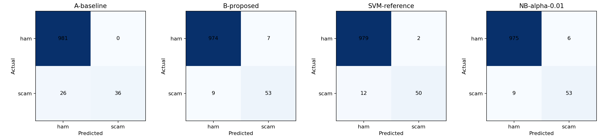
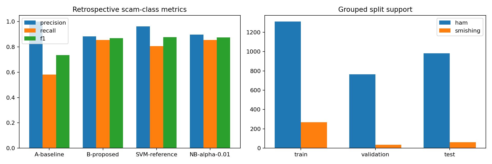

# SmishGuard NB comparison — 16 October 2026

**Validation-selected research model: `NB-alpha-0.01`. Best NB: `NB-alpha-0.01`. Production is unchanged.**

All results below were generated by end-to-end execution of `research/NB_Baseline_Proposed_Comparison.ipynb`. The October 12 corpus has already influenced earlier research. These are retrospective inherited-label results, not an independent prospective test or a deployment approval.

## Configurations and methodology

A is MultinomialNB(alpha=1.0), B is MultinomialNB(alpha=0.1). Both use the same word TF-IDF (1,2), min_df=1, max_df=1.0, max_features=None, raw TF, smoothed IDF, L2 normalization, learned class priors, no class weighting/resampling, no calibration and threshold >=0.5. Additional alpha values are .01, .5 and 2.0. LinearSVC(C=1, random_state=42, dual=auto, max_iter=10000), with margin >=0, is an additional reference.

Whitespace collapse then Unicode lowercase is identical at training and inference. No further masking, accent removal, translation or stemming is applied to the existing CSV text. The tokenizer preserves entire HTTP(S)/www URLs, including attached final punctuation, currency amounts, grouped/decimal numbers and single-character words. This retains potentially sensitive identifiers in private artifacts, so no fitted vocabulary, SMS or predictions are published.

The same conservative English stopwords are removed in A and B: `from, the, their, theirs, these, those, which, whom, whose, with, yours, yourself, yourselves`. The full English list is avoided because of Filipino/Taglish collisions such as at/may/an; negations are retained. There is no language detection or automatic Tagalog stopword removal. This controlled policy isolates alpha, rather than confounding smoothing with feature changes. It does not reproduce every possible conventional English baseline.

Selection was fixed before fitting: maximize validation scam F1, then recall, precision, smaller classifier bytes, ID. No threshold tuning or validation refit. All six configurations share identical partitions. Test evaluation IDs, selection, input hashes, source and fitted files are sealed before any test transformation. An exclusive evaluation marker refuses reruns. Vocabulary and IDF fit training messages only. No oversampling, feature selection, or test-informed fitting occurs.

## Dataset audit and leakage controls

Original ZIP: 4,261 rows; labels {'smishing': 577, 'ham': 3184, 'gambling_ad': 500}. Raw exact duplicate extras: 0; casefold/whitespace duplicate extras: 0; normalized conflicting-label groups: 0. Retained: 3,418 (3,055 ham, 363 smishing).

The 500 gambling_ad rows have no justified binary mapping and remain excluded. The existing three Kaggle-source research scope is retained; GitHub permission and team consent/use holds remain in place. Flagged labels and all normalized conflicting texts are held. Deduplication retains the first eligible normalized text before splitting. Exclusion reasons can overlap; `dataset-summary.json` gives missing values and counts, and the private cleaning ledger retains original IDs/reasons. The ZIP auxiliary CSV is not concatenated; bundled preparation scripts are not run.

The dataset README describes category/rule-derived labels and rough language guesses; these are not independently verified phishing truth. Existing source evidence records Tagalog-SMS CC0, Chua marketing CC BY 4.0 and bwandowando CC BY-NC-SA 4.0. Retain attribution and applicable restrictions; this run does not establish source licensing, redistribution or label quality.

300 label-blind connected components use supplied template keys, source-scoped sender/campaign/conversation metadata when present, and Unicode SequenceMatcher >=.85 after URL/number removal for grouping only. There are 0 mixed-label near-template components covering 0 rows, saved privately for review. Near similarity can reflect genuine ham/scam differences, so these groups are kept intact without automatic relabeling. Unknown campaigns and paraphrases can remain.

Twenty stratified group folds (seed 42) are allocated 14/3/3 for approximate 70/15/15. Groups are indivisible; size and class prevalence may drift. No favorable-seed retries. This primary evaluation is group-aware; a deliberately leaky random comparison is unnecessary. All pairwise group and normalized-text overlaps are zero.

| Partition | Rows | Ham | Scam | Scam fraction | Groups |
|---|---:|---:|---:|---:|---:|
| train | 1577 | 1310 | 267 | 16.93% | 203 |
| validation | 798 | 764 | 34 | 4.26% | 42 |
| test | 1043 | 981 | 62 | 5.94% | 55 |

Actual train/validation/test fractions are 46.14%/23.35%/30.51%. This is a substantial departure from the target, not a realized 70/15/15 split. The three largest indivisible components contain 606, 466, 417 messages. Conservatively grouping every message from the same source-scoped sender also joins unrelated messages from that sender. The fixed stratified-fold allocator does not optimize final size deviation; prevalence drift weakens threshold transfer and validation stability. No split was revised after seeing scores. Treat this as a conservative template/sender separation experiment, rather than representative traffic sampling.

Language metadata after cleaning: {'English': 2516, 'Filipino/Taglish': 902}. Tagalog and Taglish are combined in source metadata; separate metrics are unavailable. Dates are not verified receipt timestamps, so no temporal generalization is claimed.

## Validation comparison (selection evidence)

| Configuration | Alpha | Scam precision | Scam recall | Scam F1 | Macro F1 |
|---|---:|---:|---:|---:|---:|
| A-baseline | 1.0 | 100.00% | 26.47% | 41.86% | 70.13% |
| B-proposed | 0.1 | 89.66% | 76.47% | 82.54% | 90.91% |
| NB-alpha-0.01 | 0.01 | 93.10% | 79.41% | 85.71% | 92.56% |
| NB-alpha-0.5 | 0.5 | 100.00% | 26.47% | 41.86% | 70.13% |
| NB-alpha-2.0 | 2.0 | 100.00% | 2.94% | 5.71% | 51.80% |
| SVM-reference | — | 100.00% | 50.00% | 66.67% | 82.78% |

## Locked retrospective test comparison

| Configuration | Accuracy | Scam precision | Scam recall | Scam F1 | Macro F1 | FPR | FNR | TN/FP/FN/TP |
|---|---:|---:|---:|---:|---:|---:|---:|---|
| A-baseline | 97.51% | 100.00% | 58.06% | 73.47% | 86.08% | 0.00% | 41.94% | 981/0/26/36 |
| B-proposed | 98.47% | 88.33% | 85.48% | 86.89% | 93.04% | 0.71% | 14.52% | 974/7/9/53 |
| SVM-reference | 98.66% | 96.15% | 80.65% | 87.72% | 93.50% | 0.20% | 19.35% | 979/2/12/50 |
| NB-alpha-0.01 | 98.56% | 89.83% | 85.48% | 87.60% | 93.42% | 0.61% | 14.52% | 975/6/9/53 |

B minus A scam F1: validation +40.68 percentage points; test +13.42 points. These point estimates support only a bounded comparison on this corpus; no significance or universal alpha=.1 advantage is claimed. The winner remains the validation-selected configuration even if test ranking differs.

A false negative misses a scam. A false positive interrupts a legitimate SMS, including real banking or OTP messages. F1 gives a useful minority-class comparison but does not encode real deployment costs or prevalence. An all-ham classifier would achieve 94.06% test accuracy while missing every scam. Class-level precision/recall/F1/support and confusion counts are in `test-results.json`; figures are linked below.

Selected-model language metadata (descriptive retrospective results):

| Language | Ham | Scam | Scam precision | Scam recall | Scam F1 |
|---|---:|---:|---:|---:|---:|
| English | 858 | 43 | 85.37% | 81.40% | 83.33% |
| Filipino/Taglish | 123 | 19 | 100.00% | 94.74% | 97.30% |

Small positive support, rough language guesses and repeated source patterns limit interpretation. No language-specific superiority is established.

## Efficiency and offline evidence

| Configuration | Train seconds | Classifier bytes | Vectorizer bytes | JSON bytes | Host p50/p95 ms |
|---|---:|---:|---:|---:|---|
| A-baseline | 0.1800 | 791514 | 587794 | 1696130 | 1.281/3.554 |
| B-proposed | 0.2668 | 791514 | 587794 | 1690791 | 1.047/2.616 |
| SVM-reference | 0.2296 | 198315 | 587794 | 1668304 | 0.346/0.611 |
| NB-alpha-0.01 | 0.2000 | 791514 | 587794 | 1684894 | 1.024/4.095 |

Training time includes TF-IDF fitting and classifier fitting, separately recorded in JSON; it excludes grouping/serialization. Latency uses 300 warm single-message feature-transform/classifier calls over up to 100 test texts; it excludes prior whitespace normalization, loading, UI and Android execution. File sizes are actual serialized bytes and include duplicate vectorizers for independent artifacts. Host times vary with load and do not establish Android suitability.

The schema-8 JSON reference scorer independently reconstructs vocabulary lookup, n-grams, raw TF, IDF, L2 norm, NB log odds or SVM margins. Every evaluated candidate is compared on the frozen test cohort and 115 synthetic probes. `inference-summary.json` records maximum feature/score errors, named probe scores and all-unknown random-text behavior. No network service is used in fitting or inference.

Zero-feature NB input returns its training class prior. This nonzero posterior is not evidence of fraud. The diagnostic wrapper abstains on zero-feature input, while measured classification metrics retain the original model decisions. Known-word nonsense can still score highly. The wrapper is not a validated deployment policy, and neither NB posteriors nor SVM margins are calibrated real-world fraud probabilities.

The probes show a concrete deployment failure: the ordinary Taglish meeting/traffic message gets a selected-NB score of 0.99159, above its 0.5 threshold. The fictional Tagalog scam probe scores 0.06910, below threshold, while the known-word nonsense fragment scores 0.98950. All-unknown random input gets the NB class prior of 0.16931 and abstains in the reference wrapper. These synthetic probes are qualitative counterexamples, not an estimated error rate. They did not change model selection or thresholds. They are an additional reason to withhold deployment despite the aggregate F1 gain.

## Android compatibility and selected artifact

The app loads JSON through build-variant-specific loaders. SuppliedDetector handles the supplied LR model; ComparisonDetector supports legacy NB/LR/SVM contracts; selectedSvm uses SelectedSvmScorer plus the masking adapter; ResearchLinearScorer uses another separate contract. None accepts the new schema-8 full-URL/currency/single-character tokenizer. Pickles cannot be loaded directly by Kotlin. The current raw-SMS masking adapter would also change this input view.

The selected research model is `NB-alpha-0.01`, at `research/runs/nb-comparison-20261016/notebook-run-v3/NB-alpha-0.01/model.pkl`, with its `vectorizer.pkl` and `candidate-model.json`. Every evaluated candidate has a separate JSON export. All six fitted model/vectorizer pairs are retained privately. No production loader, APK, asset or warning behavior was changed.

Required before integration: implement the exact Unicode/URL/amount tokenizer and conservative stopwords in a separate Kotlin contract; reproduce feature order/IDF/L2/log-odds or margins; bypass the incompatible masking adapter; add zero-feature/invalid-input handling; test feature, score and decision parity on JVM and real offline Android devices. Run representative latency/memory checks and validate labels/prospective performance before selecting a release candidate. No actual Android parity/device benchmark for schema 8 is claimed. The preserved app integration remains the working production path.

## Limitations and validation status

Historical exposure, inherited labels, possible undetected label conflicts, source imbalance, heuristic language guesses and incomplete campaign metadata limit the evidence. Financial examples are included, but there is no independently adjudicated financial-only cohort. Excluded gambling_ad traffic is outside this binary comparison. Separate language subgroups require enough positive and negative support; counts and available metrics are recorded per candidate. No new source-held-out test, external prospective test, calibration study or statistical significance claim is made.

The notebook executed all 12 cells (5 code cells), including fresh fitting, frozen selection, single test evaluation, charts and JSON reference checks. An initial local setup attempt failed because `google` was absent during Colab detection; detection was corrected before the successful fresh run. The failed notebook is retained in the private notebook-run-v1 folder. The final fresh run adds the explicit offline abstention/invalid-input wrapper without changing fitting, feature settings, split or selection policy. Actual Google Drive mount/remote Colab execution and schema-8 Android execution remain untested.

## Files and reproduction

Added: `research/smishguard/nb_comparison.py`, `research/tests/test_nb_comparison.py`, `research/NB_Baseline_Proposed_Comparison.ipynb`, `research/nb-comparison-requirements.txt`, `scripts/create_nb_comparison_notebook.py`, `scripts/execute_nb_comparison_notebook.py`, `scripts/report_nb_comparison.py`, `scripts/verify_nb_comparison.py` and this results directory. `research/README.md` links this experiment. All existing dirty files and both older notebooks were preserved.

```powershell
research/.venv/Scripts/python.exe -m pip install -r research/nb-comparison-requirements.txt
$env:PYTHONPATH='research'
research/.venv/Scripts/python.exe -m unittest research.tests.test_nb_comparison -v
research/.venv/Scripts/python.exe scripts/create_nb_comparison_notebook.py
research/.venv/Scripts/python.exe scripts/execute_nb_comparison_notebook.py --output research/runs/nb-comparison-20261016/NEW-RUN
research/.venv/Scripts/python.exe scripts/report_nb_comparison.py research/runs/nb-comparison-20261016/NEW-RUN --output docs/nb-comparison-NEW
research/.venv/Scripts/python.exe scripts/verify_nb_comparison.py research/runs/nb-comparison-20261016/NEW-RUN --public docs/nb-comparison-NEW
```

Use a new run/output directory. Regenerating the notebook clears its saved outputs; execute it again for evidence. In Colab upload the notebook, set the ZIP path if necessary, then Run all. No intermediate cell edits are needed.

Dataset ZIP SHA-256: `38d00a999306ff11b05a431d9488f167589bd94e701f410edb24e8202bf3b3e6`. Exact schema, member hash, preprocessing, seeds, package versions and source hash are saved alongside the results. The private run also retains the executed notebook, source snapshot, cleaning ledger, groups/splits, review IDs, selection freeze, all six model/vectorizer pairs, and evaluated predictions/reports/inference checks.

[TF-IDF reference](https://scikit-learn.org/1.6/modules/generated/sklearn.feature_extraction.text.TfidfVectorizer.html), [MultinomialNB reference](https://scikit-learn.org/1.6/modules/generated/sklearn.naive_bayes.MultinomialNB.html), [StratifiedGroupKFold reference](https://scikit-learn.org/1.6/modules/generated/sklearn.model_selection.StratifiedGroupKFold.html). References support methods, not measured SmishGuard performance.





Research regression tests: Ran 155 tests in 23.053s. OK (zero failures).
