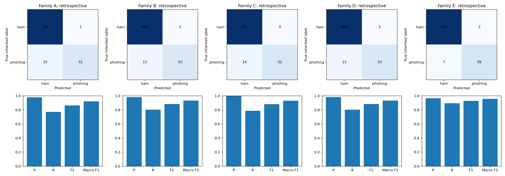
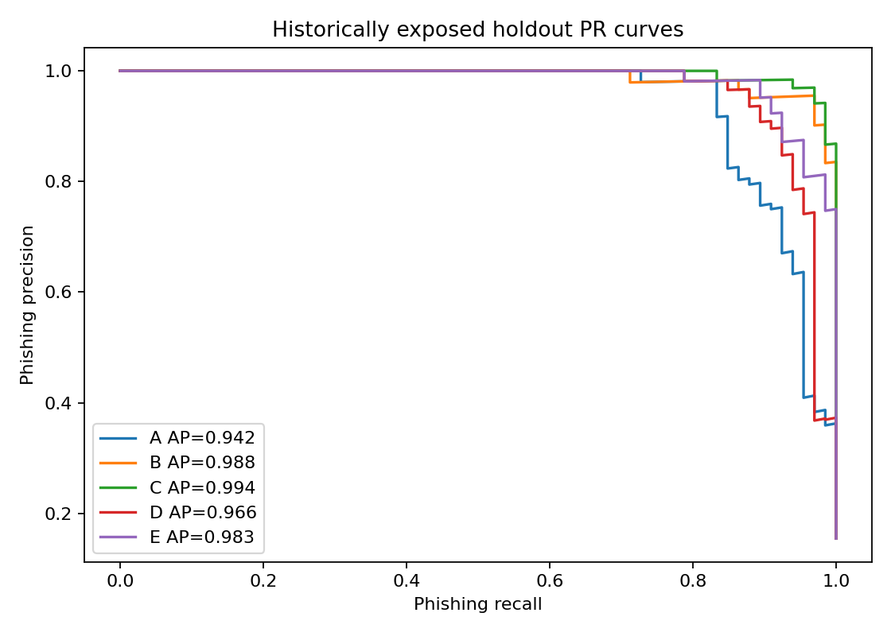
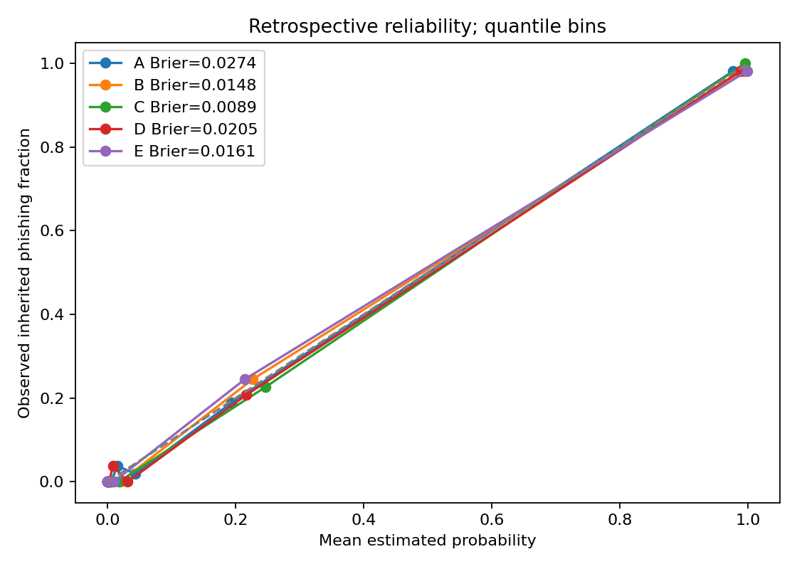

# Research-guided retraining — 13 October 2026

**Validation-selected research candidate: Word TF-IDF + NB (`E-065-sigmoid`). Production model preserved.**
The locked historical holdout gives precision 96.72%, recall 89.39%, phishing F1 92.91%. No prospective winner or thesis population-performance claim is established. The corpus has already influenced earlier experiments; repartitioning does not undo exposure.

## Method and measured audit

Upstream audit: 3340 fitting-view records, 2615 distinct input-view strings before cleaning, 727 duplicates removed and 59 flagged rows held. This run loaded exactly 2554 records/2554 unique normalized messages, 1840 heuristic template groups, 2,229 ham and 325 inherited smishing labels. Raw original source bytes and the previous cleaning ledger remain private and unchanged. New original-records/cleaning ledgers preserve the input view and original supplied labels. The input view already masks identifiers and links; it is not original SMS. No further URL, number or currency removal, translation, stemming, lemmatization or stopword removal was applied.

English: 1,709; combined Filipino/Taglish: 845. Sources: Tagalog-SMS 1,424; marketing 1,002; bwandowando 128 (positive-only). Source names do not establish language or phishing truth. Broad legitimate/spam categories require independent target-task review. No eligible normalized label conflicts or new malformed records were found; this does not prove label correctness.

| Partition | Records | Ham | Phishing | Groups | Fraction |
|---|---:|---:|---:|---:|---:|
| train | 1744 | 1514 | 230 | 1273 | 68.29% |
| validation | 383 | 354 | 29 | 292 | 15.00% |
| test | 427 | 361 | 66 | 275 | 16.72% |

Twenty stratified group folds allocate 14/3/3, targeting 70/15/15; actual size/prevalence differs because groups are indivisible. Positive prevalence is 13.19% training, 7.57% validation and 15.46% holdout. This drift and the 29 validation positives weaken threshold stability and population representativeness. No favorable-seed retry occurred. All pairwise group/exact overlap counts are zero. Grouping is label-blind .85 SequenceMatcher connected components plus exact Unicode casefold and supplied metadata. Unknown campaign/sender/conversation links and non-Latin near-template gaps can remain. Receipt timestamps are unverified, so chronology is unavailable. Only three sources exist; whole-source 70/15/15 partitions are infeasible. Separate development source-transfer diagnostics are reported, without claiming independent future-source validation.

140 raw/calibrated comparisons from 70 fitted settings; 0 fitting failures. Search time 152.3 seconds, single-threaded on this host. TF-IDF/classifiers use training only. Three training-only group folds each learn their own vocabulary/IDF; OOF margins fit a sigmoid followed by a final training-only refit. Original distribution is evaluated before paired balanced class weighting. NB alpha: 0.03, 0.1, 0.3, 1 and 3. No resampling or SMOTE is used. Word unigrams are the A/B starting baselines; bigrams, min_df and feature caps are tuned. C/D start word (1,2) + char_wb (3,5) and also test char (3,6).

Provisional operating goals were recorded before fitting: validation precision >=90%, FPR <=2%, >=5 TP. Rank eligible settings by recall, F1, AP, smaller serialized artifact, then deterministic ID. These are research requirements, pending deployment acceptance. Calibration variants are compared separately; the sigmoid wins deterministic score ties without implying universal calibration improvement. No holdout result enters selection. Family winners, thresholds and file hashes are sealed before the single holdout evaluation.

## Comparative results

| Model family | Validation P | Validation R | Validation F1 | Locked threshold |
|---|---:|---:|---:|---:|
| A: Word TF-IDF + LR | 100.00% | 44.83% | 61.90% | 0.75211827 |
| B: Word TF-IDF + SVM | 92.31% | 41.38% | 57.14% | 0.90795933 |
| C: Word + char TF-IDF + SVM | 92.86% | 44.83% | 60.47% | 0.95609553 |
| D: Word + char TF-IDF + LR | 100.00% | 48.28% | 65.12% | 0.83932261 |
| E: Word TF-IDF + NB | 91.67% | 75.86% | 83.02% | 0.51479009 |

Historical holdout, 427 identical eligible records (361 ham/66 phishing) for all five family winners. All selected modes use fitted sigmoids.

| Family | Accuracy | Precision | Recall | Phishing F1 | Macro F1 | PR-AUC | AP | ROC-AUC | TN/FP/FN/TP |
|---|---:|---:|---:|---:|---:|---:|---:|---:|---|
| A | 96.25% | 98.08% | 77.27% | 86.44% | 92.13% | 0.9421 | 0.9424 | 0.9804 | 360/1/15/51 |
| B | 96.72% | 98.15% | 80.30% | 88.33% | 93.21% | 0.9884 | 0.9885 | 0.9979 | 360/1/13/53 |
| C | 96.72% | 100.00% | 78.79% | 88.14% | 93.12% | 0.9944 | 0.9944 | 0.9990 | 361/0/14/52 |
| D | 96.72% | 98.15% | 80.30% | 88.33% | 93.21% | 0.9654 | 0.9656 | 0.9876 | 360/1/13/53 |
| E | 97.89% | 96.72% | 89.39% | 92.91% | 95.84% | 0.9828 | 0.9829 | 0.9964 | 359/2/7/59 |

PR-AUC is trapezoidal area; AP is separately reported. Accuracy alone is insufficient: an all-ham predictor would score 84.54% accuracy here while missing every phishing SMS. A matched character ablation fixes C=0.1, balanced weights, word (1,2), min_df=1, no feature cap and the same calibration folds, changing only the char_wb block. Validation AP increases from 0.7878 word-only to 0.8254 combined; qualifying recall from 41.38% to 44.83%. Each uses the original validation operating rule. This post-selection development diagnostic is not independent confirmation and cannot change the winner. The original preserved SVM baseline replay gave 95.24% F1 on its different 498-record historical partition, with zero score difference; LR 91.67%, NB 87.41%. These are not directly comparable to this new membership, training allocation or operating policy. The reversal of validation ranking is counterevidence to an assumed universal SVM winner.

## Probability handling and efficiency

| Family | Brier, historical holdout | Fit seconds incl. calibration | Pickle MiB | Features | Sparse train MiB | Host single p50/p95 ms |
|---|---:|---:|---:|---:|---:|---|
| A | 0.02739 | 0.751 | 0.442 | 9265 | 1.039 | 0.465/0.642 |
| B | 0.01484 | 0.925 | 0.442 | 9265 | 1.039 | 0.470/0.584 |
| C | 0.00887 | 3.323 | 1.784 | 64829 | 7.572 | 1.324/2.068 |
| D | 0.02052 | 3.017 | 1.402 | 33098 | 7.209 | 1.223/1.814 |
| E | 0.01612 | 0.614 | 0.654 | 9265 | 1.039 | 0.851/1.118 |

Host single-message latency uses 100 holdout messages and includes feature transformation; wall times vary by host/load. Sparse bytes are storage for the training CSR matrix, not peak RAM. Reliability curves/bins are saved. The selected NB validation Brier improves from 0.02823 raw to 0.02275 sigmoid; ranking and chosen confusion counts tie. OOF-to-full-fit score shift, inherited labels, sample size and unknown deployment base rate prevent a real-traffic probability claim. SVM raw margins have Brier=null. Native candidate results always set probability=false; no “chance of phishing” certainty claim is introduced.

## Language and subgroup findings

| Selected NB language metadata | Records | Ham | Phishing | Precision | Recall | F1 |
|---|---:|---:|---:|---:|---:|---:|
| English | 324 | 266 | 58 | 96.23% | 87.93% | 91.89% |
| Filipino/Taglish | 103 | 95 | 8 | 100.00% | 100.00% | 100.00% |

The combined Filipino/Taglish subgroup has only eight positives; its perfect observed counts do not establish broad multilingual robustness. Separate Tagalog/Taglish and reliably labeled banking, OTP, verification, delivery and conversation subgroups are unavailable. Inherited impersonation categories include government/courier/brand, so they are not automatically financial-impersonation labels. The aggregate JSON contains all family subgroup supports. Two-class metrics require >=20 messages and >=5 each class; single-class category counts are preserved without misleading AUC/F1.

Controlled validation-only surface edits of existing messages gave zero NB prediction flips: uppercase 380 changed records; whitespace 383; terminal punctuation 383; targeted spelling obfuscation 77; Taglish spelling 7. The seven Taglish edits are all ham and cannot establish scam robustness. Scores/rankings can change even without threshold flips. These are supplementary assumed label-preserving transformations, pending semantic review, not newly collected SMS or security guarantees. Source/link-only controls, frozen URL removal and source-complement fitting diagnose shortcuts, but tuned validation diagnostics do not prove genuine indicators or source invariance.

Conditional cluster-bootstrap 95% intervals (1,000 draws, fixed selected model): recall 66.67%–96.83%, precision 85.00%–100.00%, F1 75.47%–97.44%. They exclude selection, exposure, label and fitting uncertainty. At the locked threshold, seeds 42/43/44 gave validation F1 83.02/78.43/83.02% and recall 75.86/68.97/75.86%; membership/settings remain fixed. This is fitting/calibration variability, not an independent outer-split comparison.

## Offline candidate validation

The selected configuration is NB alpha=0.03, word (1,2), min_df=2, max_features=20,000, original class distribution, OOF sigmoid and threshold >=0.5147900878024994. Export uses validated JSON weights/IDF/ordered vocabulary/Unicode tables and preserves positive class smishing at index 1. The separate ResearchLinearScorer implements independently normalized word/char blocks, codepoint character slices and sklearn short-word padding. ResearchLinearRawDetector uses the existing frozen raw-SMS masking adapter; original input length is checked before masking. No network dependency or production loader registration is added. Python pickles remain research-only.

| Actual exported candidate | JSON bytes | JVM max score error | API36 max score error | Emulator load ms | Synthetic score p50/max ms |
|---|---:|---:|---:|---:|---|
| E: Word TF-IDF + NB | 811504 | 5.55e-16 | 5.55e-16 | 219.91 | 0.197/42.546 |
| C: Word + char TF-IDF + SVM | 4940204 | 1.80e-16 | 1.80e-16 | 622.88 | 0.365/89.760 |

Each actual export passed 20 synthetic masked probes plus 31 synthetic raw-SMS adapter probes on JVM and API36 emulator, airplane mode on and INTERNET permission absent. Both also match all 427 already locked real masked holdout scores and decisions within 1e-10; every record is assessable with zero failures/abstentions on this cohort. The raw-SMS adapter is idempotent on these existing fitting views. These engineering repetitions do not change research selection/evaluation or provide fresh labels. Synthetic feature/score errors are below 6e-16; real-score errors are recorded separately in the aggregate JSON. Empty/unknown text abstains; NUL, malformed surrogates and oversized input fail safely. Whole instrumentation process PSS samples: NB 160,547→167,862 KiB; combined SVM 160,430→179,446 KiB. These are not isolated model RAM. Actual masked-message detection p50/p95 ms on this emulator: NB 0.633/1.423; combined SVM 1.166/2.863. Synthetic timings include an unusually long message, are single-pass measurements, and are not representative physical-device benchmarks. Current production assets/notebook and preserved artifacts passed all 23 original hash checks. Newly built debug test APKs are private engineering artifacts; no active candidate APK or production pointer was replaced.

## XLM-R, rights, limitations and recommendation

F: XLM-R was not trained. This research environment lacks torch/transformers and a pinned XLM-R checkpoint; hardware acceleration was not demonstrated. Existing mBERT results cannot substitute. No original authorized-text transformer comparison, weighted-loss result, checkpoint/export or mobile benchmark is claimed. Future work must pin checkpoint/revision/license/dependencies, use native tokenizer without TF-IDF cleaning, reuse eligible membership and record ordinary versus weighted loss/resource costs.

Source terms are the historically pinned records in [source evidence](source-evidence.md): Tagalog-SMS CC0, marketing CC BY 4.0, bwandowando CC BY-NC-SA 4.0. Retain attribution/change/license records. Acquisition lineage, privacy/redaction, independent labeling and intended thesis/distribution scope remain separate human reviews. No personal/social source is admitted, no open accessibility is treated as blanket rights, and no fitted vocabulary/SMS is included in public reports.

Recommend NB as the candidate for this prespecified retrospective comparison, with combined SVM retained for future comparison. Do not change production from these results: independent labels, truly untouched prospective messages, separate language/scam annotations and physical Android device tests remain necessary. The small validation-positive support, prevalence drift, heuristic grouping and ranking reversal prevent a conclusive universal deployment choice. Review the nine holdout errors and upstream 59 flagged records privately. A private scope-review queue flags 70 inherited gambling-lure messages whose phishing/scam-versus-marketing status needs human adjudication. These remained in the declared inherited-label exploratory comparison, so all deployment claims remain inadmissible until label quality is resolved. No labels were changed.

## Reproduction, tests and artifact trace

From repository root, set PYTHONPATH=research and use research/.venv/Scripts/python.exe (Python 3.12). Use new output directories; the shown completed run refuses overwrite.

```text
python -m pip install -r research/retraining-requirements.txt
python -m smishguard.retraining train research/runs/bantaytext-20261013/notebook-run-v3/dataset.json research/runs/retraining-20261013/NEW-RUN --history previously_used
python -m smishguard.retraining evaluate research/runs/bantaytext-20261013/notebook-run-v3/dataset.json research/runs/retraining-20261013/NEW-RUN
python -m unittest discover -s research/tests -v
python scripts/replay_retraining_baseline.py --output research/runs/retraining-20261013/NEW-BASELINE-REPLAY.json
backend/.venv/Scripts/python.exe -m unittest discover -s backend -v
python scripts/execute_retraining_notebook.py --run runs/retraining-20261013/notebook-run-v2 --replay
python scripts/prepare_retraining_parity.py research/runs/retraining-20261013/run-v1 --output research/runs/retraining-20261013/NEW-PARITY --legacy-parity research/runs/bantaytext-20261013/notebook-run-v3/parity
gradlew.bat :app:testDebugUnitTest :app:lintDebug :app:assembleDebug :app:assembleDebugAndroidTest -PmodelParityDir=ABSOLUTE_PRIVATE_PARITY_DIRECTORY --console=plain
adb -s emulator-5554 shell am instrument -w -r -e researchParity true -e class ph.smishguard.ResearchLinearAndroidTest ph.smishguard.test/ph.smishguard.SoftwareTestRunner
python scripts/report_retraining.py research/runs/retraining-20261013/notebook-run-v2
```

Research tests: **145 passed**, including 15 new guards. Backend: **46 passed** in its established environment. Latest full JVM suite: **37 tests, 31 passed, 6 optional artifact-dependent tests skipped, zero failures/errors**; both actual NB and combined SVM parity runs passed. Build/lint/test APK checks passed; four API36 instrumentation runs passed one candidate test each, including the two strengthened runs with real masked cohort coverage/latency. Notebook: all 17 cells executed end-to-end in a fresh run, including fitting, locking and retrospective holdout evaluation. The first run is preserved with its exact source snapshot. A label-0 missing-count reporting bug was corrected; it did not alter labels, splits or model fitting. The fresh run has identical split membership, selected settings/thresholds, native inference parameters and all five holdout prediction vectors (zero score differences). The preserved selectedSvm variant also builds and passes 37 JVM tests (32 executed, five optional tests skipped). Initial comparator fixture failures and wrong-venv Flask failure are preserved in audit-v1 logs; no assertions were weakened.

Notebook: `research/Model_Training_and_Evaluation.ipynb` (self-contained embedded implementation, configurable CSV/JSON/ZIP/Drive input, clean setup instructions). Prepared input must use the documented existing masked fitting view for this Android adapter; raw corpus preparation/lineage must precede using a different input. Established notebook unchanged. Pipeline: `research/smishguard/retraining.py`. Private run: `research/runs/retraining-20261013/notebook-run-v2/` (dataset, ledgers, splits, configuration, selection, freeze, fitted pipelines, predictions, curves, errors, metadata). Actual native candidates and parity: `research/runs/retraining-20261013/parity-E-v2/` and `parity-C-v2/`. Public aggregate JSON/CSV and figures accompany this report; their experiment file hashes trace every reported metric.







Method references: [version-matched TF-IDF](https://scikit-learn.org/1.6/modules/generated/sklearn.feature_extraction.text.TfidfVectorizer.html), [calibration](https://scikit-learn.org/stable/modules/calibration.html), [XLM-R paper](https://arxiv.org/abs/1911.02116), [checkpoint card](https://huggingface.co/FacebookAI/xlm-roberta-base). These support methodology/provenance, not a SmishGuard performance claim.
