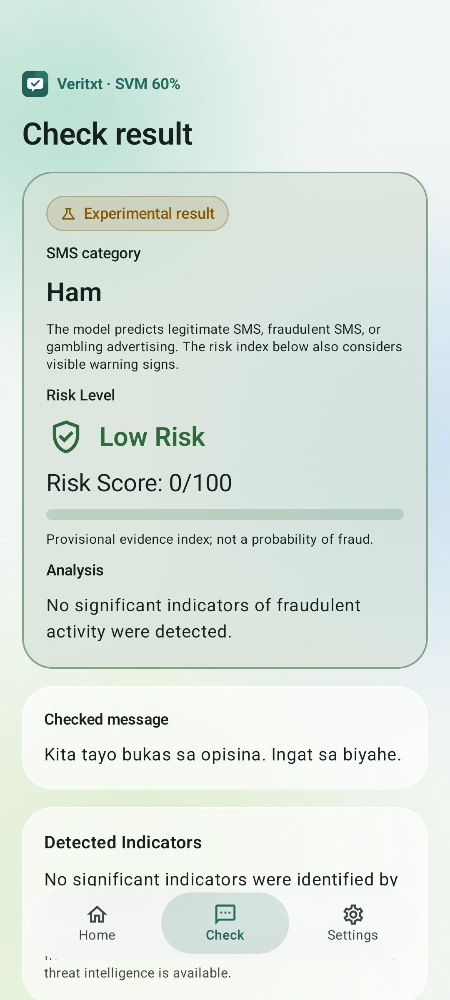
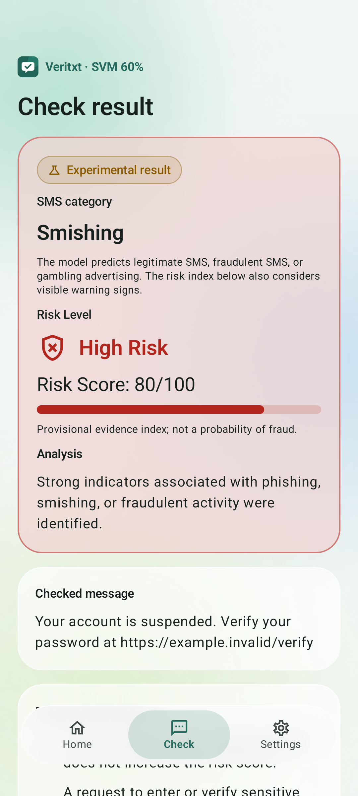
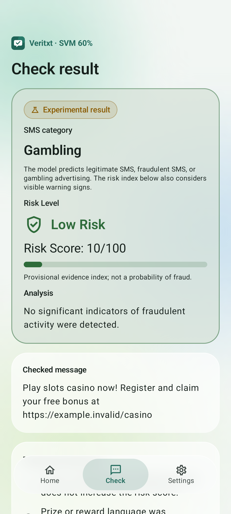

# VeriTxt SVM 60% application deployment — 20 October 2026

The requested exact frozen SVM 60% model has been integrated, built into a new debug APK, and tested on an API 36 emulator. The SVM 80% APK, both frozen Python pipelines, original dataset and completed research results are preserved.

**The switch does not fix the cashback example. Both frozen Python models and their Android scorers return Ham for that input, and the unchanged risk rules return Low Risk, 0/100.** The 20 documented practical inputs produced identical category predictions across the two models. This is the user's requested application testing choice, not measured proof that the 60% model is superior. The thesis's original controlled 80% comparison and its uncertainty are unchanged.

## New APK and exact source

- APK: `C:\Users\Jassim Trinidad\OneDrive\Desktop\smishguard\deliverables\multiclass-svm-60-20261020\VeriTxt-LinearSVM-60-New.apk` (22,090,025 bytes).
- APK SHA-256: `a91374643aff97ea9d83623750bcc3d1035c8e4ff5e0e4cec41864a44fa4f42f`.
- Build: **debug**, signed using the existing local debug configuration; APK Signature Scheme v2 verified. No signing credential was created or exposed.
- Launcher label: **VeriTxt · SVM 60%**.
- Application ID: `ph.smishguard.svm.multiclass60`; version `0.3.0-svm60-debug`.
- Minimum API 26 / Android 8.0; target/compile API 36. Only API 36 runtime testing was performed.
- Source: `C:\Users\Jassim Trinidad\OneDrive\Desktop\smishguard\research\runs\multiclass-20261020\run-v1\svm-60.pkl`.
- Source pipeline SHA-256: `73c996492889c846a396aba1b6f250eb3e488605104cb18c5318bb75c9dc605a`.
- Packaged `assets/model.json` SHA-256: `3703fdb51583f090979ada04fc79201e58cbeb61b0a464cb6389b0baf5b07dd1`.

The frozen study's selection.json, configuration.json, environment.json, training-seal.json, PROTOCOL.md and THESIS-REPORT.md were inspected. The actual artifact verifies LinearSVC(C=10), classes [0,1,2], 30,227 features and three coefficient rows. It was fitted on the 2,281-record training portion; 761 validation records selected C, and 761 test records formed the shared final evaluation. Validation records were not incorporated into fitting this model. No new training, calibration, threshold tuning or thesis-test evaluation was run.

Class mapping remains 0=Ham, 1=Smishing, 2=Gambling. This model is neither the 3,042-record `svm-80.pkl` nor a historical binary SVM. File hashes, metadata, dimensions and explicit build-selected training percentage prevent substitution.

The distinct package suffix allows both application versions to remain installed. Open the new **SVM 60%** app to use this model; the previous SVM 80% application is not silently replaced or redirected.

## Original issue and risk investigation

The message was:

> [EWB]You have PHP 5,216 available for cashback. Claim it before it expires today

| Frozen pipeline | Prediction | Ham margin | Smishing margin | Gambling margin |
| --- | --- | ---: | ---: | ---: |
| SVM 60% | Ham | 0.358004305 | -0.557602564 | -0.852138840 |
| SVM 80% | Ham | 0.216815813 | -0.437241689 | -0.865929823 |

Both choose the largest raw margin, Ham. Margins are uncalibrated one-versus-rest decision values, not probabilities or the app's risk index. This comparison does not authenticate EWB or verify that the message is fraudulent. No independent human-verified expected label was supplied. If independently confirmed as fraudulent, the Ham outcome would be a false negative for both models.

The risk score is a separate existing heuristic system in RiskAssessment.kt. It combines credential/payment requests, selected urgency/reward keywords, certain URL indicators and a model signal. A Smishing prediction supplies 40 points; a Ham or Gambling prediction does not. The score is Low below 30, Medium from 30 through 69 and High from 70 onward. These thresholds are unchanged.

The cashback example receives no model-signal points because it is Ham. The existing reward expression includes `won`, `winner`, `prize`, `claim your`, `nanalo` and `premyo`, but not `cashback` or `claim it`. The urgency expression does not include `expires today`. There is no matching request for credentials/payment in the supplied text, and it contains no URL. An identity hint, if detected, carries zero points. Thus no positive-weight indicator fires and the risk score is zero. **Zero is not a 0% fraud probability or a guarantee of safety.** The inherited reassuring wording remains a known limitation.

RiskAssessment.kt was hash-checked unchanged. No heuristic, risk weight, risk threshold, warning condition or safety override was added. Android tests separately verify the cashback result is Ham/Low/0 under both models, and that an explicit credential-request example can trigger High Risk through the existing rules independently of a model prediction.

## Exact inference integration

The new export copies the fitted vocabulary in its original index order, IDF array, 3×30,227 coefficients and three intercepts. Arrays were verified for exact equality after JSON serialization. Unicode tables and tokenizer settings come from the already verified shared feature contract, and vectorizer parameter dictionaries were checked equal across the two original pipelines.

Preprocessing remains whitespace collapse and Python-compatible Unicode 15 lowercase, including expanding lowercase and Greek final sigma. The original URL/currency/number/Unicode-word token pattern, 13 conservative stopwords, stopword removal before bigrams, unknown-token adjacency, raw TF, smooth IDF and L2 normalization are retained. No masking adapter, translation, stemming, probability sigmoid, new learned transform or feature approximation is introduced. All three margins use the original dot products and intercepts. Argmax selects the first class on an exact tie, including when all scores are negative.

MulticlassSvmDetector now supports explicitly requested 60% and 80% identities while sharing unchanged numerical inference. The default remains 80% for the old build. The `multiclassSvm60` build explicitly requests 60%, pins the new export hash and validates the 60% source artifact/version/features/training count. The old build and model asset remain available for rollback. The new application APK contains exactly one asset, the 60% `model.json`; the 80% model is used only in the separate test APK for comparison and is absent from the new application APK.

The current three-category UI and separate risk display remain. The only visible identification change is SVM 60% in the app label/header/status. Manual checks, pasted/shared SMS, notification-opened checks and opt-in incoming-SMS classification use the same active 60% detector. Consent, settings, languages, themes, privacy clearing, disabled reporting and Android blocking handoff are retained. No READ_SMS, INTERNET or other new Android runtime permission was added; existing RECEIVE_SMS and POST_NOTIFICATIONS remain. The app still has no persisted inbox/history or bulk historical inbox scanner.

Blank/invalid/over-limit input handling is retained separately from mathematical model scoring. Raw mathematical parity includes intercept-only predictions on empty/OOV input. The app still abstains on blank inputs and standalone phone/URL/email inputs and rejects malformed NUL/unpaired-surrogate or over-limit text. These guards do not retune the selected model.

## Practical comparison before switching

The exact user-provided example and 19 documented synthetic scenarios were transformed by both frozen Python pipelines before replacing the app's inference path. Scenarios cover informational/conversational SMS, cashback and expiry language, simulated bank/delivery/credential lures, shortened and ordinary URLs, Filipino/Taglish, unknown sender-style names, gambling and short/ambiguous text. Scenario descriptions are intended test construction, not reliable fraud labels. None has an independently verified human label; no accuracy or empirical superiority is calculated from this set.

Decision scores below are ordered **Ham, Smishing, Gambling**. Complete precision and provenance are retained in practical-comparison.json/CSV; observed Android scores are in practical-android-parity.json. Each model's Android prediction matches its frozen Python prediction on every row. Across models, all 20 predicted labels agree; differing margins do not establish that one model has higher calibrated confidence.

| Input SMS | SVM 60% | 60% margins | SVM 80% | 80% margins | Human-verified label | Android matches Python |
| --- | --- | --- | --- | --- | --- | --- |
| [EWB]You have PHP 5,216 available for cashback. Claim it before it expires today | Ham | 0.358004, -0.557603, -0.852139 | Ham | 0.216816, -0.437242, -0.865930 | Unavailable | Yes, both models |
| [EWB]You have PHP 5,216 available for cashback. Claim it before it expires today at https://example.invalid/claim | Ham | 0.242495, -0.589721, -0.701613 | Ham | 0.123508, -0.484103, -0.720920 | Unavailable | Yes, both models |
| Your account is suspended. Verify your password at https://example.invalid/verify | Smishing | -0.312354, 0.369693, -1.188030 | Smishing | -0.582121, 0.633096, -1.167383 | Unavailable | Yes, both models |
| Your parcel is on hold. Pay a delivery fee at https://example.invalid/delivery to release your package. | Ham | 1.003528, -0.793043, -1.262600 | Ham | 0.951162, -0.825646, -1.196527 | Unavailable | Yes, both models |
| Your bank account is suspended. Send your OTP and PIN to https://example.invalid/account immediately. | Ham | 0.529172, -0.560130, -1.043062 | Ham | 0.307079, -0.301345, -1.090627 | Unavailable | Yes, both models |
| Your account is locked. Act now: https://bit.ly/fictional-veritxt-test | Smishing | -0.337913, 0.345930, -1.054444 | Smishing | -0.512808, 0.542408, -1.090217 | Unavailable | Yes, both models |
| Na-lock ang iyong account. Ibigay ang iyong OTP ngayon sa https://example.invalid/claim | Ham | 0.304514, -1.076232, -0.241905 | Ham | 0.253901, -1.045839, -0.232617 | Unavailable | Yes, both models |
| Urgent po! Pakiverify ang account mo ngayon para hindi ma-suspend. https://example.invalid/verify | Ham | 0.185164, -0.628530, -0.535222 | Ham | 0.097811, -0.554399, -0.501309 | Unavailable | Yes, both models |
| [ZXNOTICE] Your account needs verification immediately. Please visit https://example.invalid/update | Smishing | -0.603999, 0.641260, -1.111729 | Smishing | -0.802493, 0.791854, -1.101607 | Unavailable | Yes, both models |
| Your reward expires today. Claim it now at https://example.invalid/reward | Smishing | -0.121538, -0.062350, -0.815739 | Smishing | -0.271125, 0.182040, -0.932793 | Unavailable | Yes, both models |
| Kita tayo bukas sa opisina. Ingat sa biyahe. | Ham | 0.531046, -1.097241, -0.448163 | Ham | 0.588273, -1.097952, -0.503761 | Unavailable | Yes, both models |
| The meeting starts tomorrow at nine. Bring your notes. | Ham | 0.388507, -0.852987, -0.554265 | Ham | 0.295602, -0.793111, -0.528487 | Unavailable | Yes, both models |
| Ma, late ako uuwi. May meeting pa sa office. Ingat po! | Ham | 0.257176, -0.378291, -0.868976 | Ham | 0.142218, -0.449487, -0.700815 | Unavailable | Yes, both models |
| Your OTP is 123456. Never share this code with anyone. | Ham | 1.612658, -1.465173, -1.225322 | Ham | 1.684134, -1.513625, -1.297394 | Unavailable | Yes, both models |
| Your monthly statement is available in your banking app. Open the app directly to view it. | Ham | 1.333112, -1.134279, -1.293853 | Ham | 1.347091, -1.184334, -1.279325 | Unavailable | Yes, both models |
| Play slots casino now! Register and claim your free bonus at https://example.invalid/casino | Gambling | -1.150734, -1.075650, 1.180076 | Gambling | -1.336297, -1.053151, 1.333321 | Unavailable | Yes, both models |
| Laro na sa online casino! May libreng bonus at slots para sa iyo. | Gambling | -0.743375, -1.342432, 1.046314 | Gambling | -0.861577, -1.271932, 1.067906 | Unavailable | Yes, both models |
| Claim your cashback in the official app before the offer expires. | Ham | 0.221259, -0.706121, -0.564382 | Ham | 0.182597, -0.712026, -0.545988 | Unavailable | Yes, both models |
| Please call [synthetic phone redacted] when you arrive. | Ham | 0.396936, -0.561602, -0.892160 | Ham | 0.474212, -0.510140, -1.073088 | Unavailable | Yes, both models |
| Hi | Ham | 0.467316, -0.955597, -0.501069 | Ham | 0.452519, -0.959533, -0.471651 | Unavailable | Yes, both models |

## Numerical consistency and model selection guards

| Check | JVM | Android API 36 |
| --- | ---: | ---: |
| 60% parity fixtures | 954 | 954 |
| Matching labels | 954 | 954 |
| Mismatches | 0 | 0 |
| Maximum margin error | 2e-15 | 2e-15 |
| Maximum TF-IDF error | 6.66e-16 | 6.66e-16 |
| Absolute tolerance | 1e-10 | 1e-10 |

The independent fixture set contains practical inputs, synthetic/Unicode/whitespace/URL/number/tokenizer stress cases, empty/long/invalid inputs, 400 deterministic fuzz probes and coverage of every 60% vocabulary term. It contains zero thesis test messages. The active app path matched direct model handling on 948 message-shaped fixtures within app boundaries. In addition, the practical comparison checked 40/40 model predictions across both frozen models, with zero mismatches and maximum margin error 6.66e-16. These are software consistency tests, not classification accuracy estimates.

Tests verify the actual detector reports trainingPercent=60, reject an 80% asset when 60% is requested, reject a 60% asset when 80% is requested, and preserve correct class order and exact tie behavior. Android initialization therefore cannot silently succeed with an old or differently trained model.

## Build and device verification

The Gradle build completed successfully: assembleMulticlassSvm60, lintMulticlassSvm60, testMulticlassSvm60UnitTest and assembleMulticlassSvm60AndroidTest. Lint: 0 errors, 11 warnings. Host unit tests: 41 passed, 13 skipped for other/private variants, zero failures/errors. All three new SVM 60% unit tests executed and passed. The existing local debug signature verifies with APK Signature Scheme v2. Packaged model bytes were checked against the exact export before installation and packaging.

The exact APK checksum in this report was installed and launched on a verified API 36 emulator. Numerical parity ran in airplane mode. Synthetic incoming SMS were injected through the emulator console with its cellular radio enabled; no carrier SMS or physical device was used. Prior emulator network settings were restored afterward.

| Instrumentation group | Tests | Result |
| --- | ---: | --- |
| native-parity | 1 | Passed |
| manual-three-categories | 1 | Passed |
| existing-flows | 6 | Passed |
| privacy-lifecycle | 2 | Passed |
| risk-results | 8 | Passed |
| theme-settings | 1 | Passed |
| real_model_incoming_sms | 1 | Passed |

Total: 20 instrumentation tests passed. These include actual 60% model initialization, all three displayed categories, both-model practical comparison, unchanged risk behavior, manual/shared/pasted input, permission denial, navigation/clearing, privacy lifecycle, existing risk/blocking screens, theme settings and a real emulator incoming-SMS notification flow using the active classifier. The normal non-test app process was launched successfully after instrumentation. No crash occurred in these tested workflows.

## Preservation and modified files

SHA-256 verification confirmed preservation of all 173 files in the pre-change manifest: the complete frozen multiclass experiment, original dataset ZIP, original research reports/protocol/results/figures, earlier 80% integration evidence, historical model assets and historical APK files. RiskAssessment.kt is also unchanged. The thesis's observed 80% SVM advantage and uncertainty are not rewritten because of this deployment choice. Original test/CV metrics were neither recomputed nor relabeled.

Changes are limited to:

- New private `src/multiclassSvm60/assets/model.json` and ignored-directory entry.
- `MulticlassSvmDetector.kt`: explicit 60/80 model-identity validation and training-percentage status, retaining shared feature/math code and default 80% behavior.
- `SmishGuardApp.kt`: explicit build-selected 60% loading and asset hash validation.
- `MainActivity.kt`: SVM 60% header identification; existing result UI retained.
- `android/app/build.gradle.kts`: separate 60% debug build, asset guard and fixture wiring.
- Shared parity helper: optional explicit training percentage, default 80% unchanged.
- New Svm60ParityTest, Svm60AndroidTest, Svm60FlowTest and Svm60PracticalParity tests.
- New export_svm60_android.py, build_svm60.ps1, verify_svm60_apk.py, package_svm60.py and report_svm60_deployment.py scripts and this separate deployment-report directory.

## Install and roll back

This APK is a **debug build**, despite the requested filename ending in `-New.apk`. Copy it to an Android 8.0+ device, open it and accept Android's installation prompt for the file-manager source. Launch **VeriTxt · SVM 60%** to use it. It installs alongside the SVM 80% app; settings are separate. Enable incoming scanning and existing permissions only through the normal in-app controls.

With an explicitly selected USB-debugging device:

```powershell
adb -s DEVICE_SERIAL install -r "C:\Users\Jassim Trinidad\OneDrive\Desktop\smishguard\deliverables\multiclass-svm-60-20261020\VeriTxt-LinearSVM-60-New.apk"
adb -s DEVICE_SERIAL shell am start -n ph.smishguard.svm.multiclass60/ph.smishguard.MainActivity
```

Rollback requires no model conversion or retraining: open the existing **VeriTxt · SVM 80%** app. If it is not installed, reinstall this preserved original APK:

`C:\Users\Jassim Trinidad\OneDrive\Desktop\smishguard\deliverables\multiclass-svm-80-20261020\VeriTxt-LinearSVM-80-New-debug.apk`

Its original SHA-256 remains `e31e440d1e02512b0cf2718cde2fcf87e3f7cc9de944eb0fe5e8ad1dcfd0d8ec`; package `ph.smishguard.svm.multiclass80`. Enable incoming scanning only in the version you intend to use to avoid duplicate notifications from two independently enabled apps. The old 80% asset and frozen `svm-80.pkl` also remain unchanged in the project.

## Reproduction and limitations

From the project root with the existing research environment:

```powershell
$env:PYTHONPATH='research'
.\scripts\build_svm60.ps1
research\.venv\Scripts\python.exe scripts/verify_svm60_apk.py --output research/runs/svm60-android-20261020/NEW-VERIFICATION
```

The completed export and private test fixtures are in `research/runs/svm60-android-20261020/export-v1/`. On a fresh source checkout with authorized private frozen artifacts, export_svm60_android.py creates a fresh output and the private 60% asset without fitting; it refuses to replace an existing export asset. Pass another completed fixture directory via build_svm60.ps1 -ParityDir. Signature verification and package_svm60.py guard the tested APK checksum, sole asset, original-file preservation and test/lint results before creating a fresh deliverable directory. All new artifacts are separate from research outputs.

Physical-device/OEM/background behavior, runtime versions other than API 36, release signing/distribution and independent prospective labeled SMS are unverified. The 20 practical examples are not an independent accuracy study, and none has a reliable supplied human label. This application switch is experimental and user-directed; it does not establish improved fraud detection, fix the cashback example, change the thesis conclusion or make the heuristic score a probability. The model's and risk system's demonstrated limitations remain visible evidence for future separately evaluated improvements.







Public sharing note (31 October 2026): the synthetic contact number in the practical-comparison text is redacted. Historical scores, feature vectors, and artifact hashes describe the original local run and were not recomputed. Runnable probes now use the reserved fictional number +1 202 555 0100.
